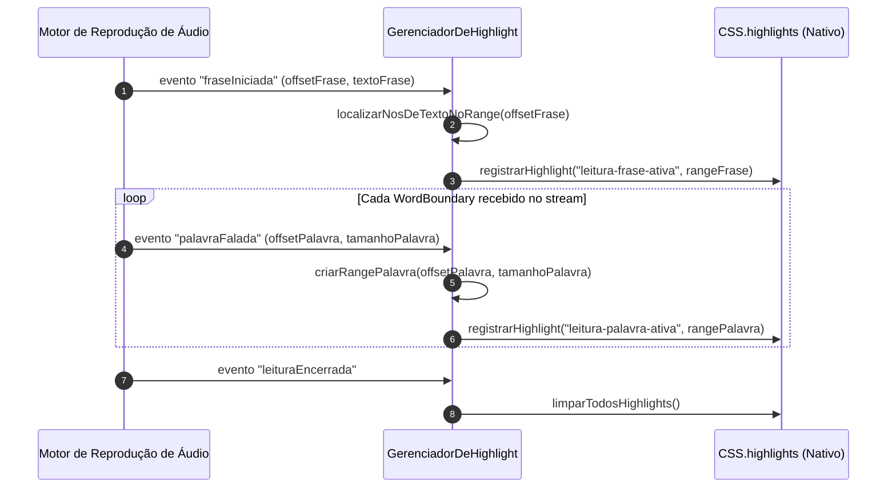

# Plano de Implementação: Sincronizador de Highlight Não-Destrutivo (CSS Custom Highlight API)

> **Status:** Em Planejamento (Exemplo Referência)  
> **Data de Criação:** 2026-10-17  
> **Arquivo Alvo:** `.metadocs/implementation_plan/highlight_nao_destrutivo.md`  
> **Stack & Regras Aplicadas:** JavaScript Moderno (ES6+) | CSS Custom Highlight API | `.agents/rules/code.md` | `.agents/rules/javascript.md`

---

## 1. Visão Geral e Contexto de Negócio

### 1.1 Objetivo Técnico
Implementar o motor de destaque visual de texto (sincronização de frase atual e palavra corrente falada) no `content_script` da extensão, sem modificar a árvore DOM hospedeira, utilizando a **CSS Custom Highlight API** (`CSS.highlights` e objetos `Range`).

### 1.2 O Pilar "Por que?" (Racional Arquitetural e Decisões de Projeto)
- **Problema a Resolver:** Abordagens convencionais de extensões envolvem envolver palavras em tags `<span>` ou `<mark>`. Isso causa dois problemas graves em produção:
  1. Quebra de reconciliação e estado interno em Single Page Applications (SPAs) baseadas em React, Vue e Angular, podendo provocar crashes da página ou perda de inputs;
  2. *Reflow* e *re-layout* pesados no motor de renderização Blink a cada palavra falada, degradando a performance e gerando travamentos visuais.
- **Alternativas Consideradas vs. Escolha Adotada:**
  - *Opção A: Injeção de tags `<mark>` no DOM:* Descartada por violar o princípio de não-destrutividade e quebrar SPAs.
  - *Opção B: Overlay flutuante em Canvas/SVG:* Descartada devido à alta complexidade de cálculo de posição sob zoom, fontes responsivas e scroll dinâmico.
  - *Opção C: CSS Custom Highlight API (Adotada):* Solução nativa do Chromium (Chrome/Edge/Brave 105+), desacoplada do DOM. Os objetos `Range` apontam para os nós de texto existentes sem alterar a hierarquia do documento, e a renderização é realizada pelo próprio pipeline de pintura da engine gráfica.
- **Trade-offs Técnicos:** Requer suporte a navegadores baseados em Chromium modernos (já previsto no PRD para Edge e Brave). Caso a API não esteja presente, aplica-se fallback gracioso de não-destaque sem interromper o áudio.
- **Alinhamento com Diretrizes de Engenharia:** Em conformidade com o princípio de responsabilidade única (SRP), sem abreviações em variáveis (`indiceInicioPalavra`, `intervaloFraseAtual`), com *guard clauses* para nós inválidos e tratamento estrito de memória.

---

## 2. Diagramas de Arquitetura e Fluxo de Execução



---

## 3. Mapeamento Estrutural de Arquivos

| Ação | Caminho do Arquivo | Responsabilidade Única (SRP) |
|---|---|---|
| `Criar` | `src/content/destaque/GerenciadorDeHighlight.js` | Gerenciar o ciclo de vida dos objetos `Range` e o registro na `CSS.highlights`. |
| `Criar` | `src/content/destaque/LocalizadorDeNosTexto.js` | Percorrer a seleção original e mapear offsets absolutos para nós de texto concretos (`TextNode`). |
| `Criar` | `src/content/destaque/estilos_highlight.css` | Definir as pseudo-classes `::highlight(leitura-frase-ativa)` e `::highlight(leitura-palavra-ativa)`. |

---

## 4. Especificação Técnica Detalhada por Módulo (O "Como?" e o "Por que?")

### 4.1 Módulo: `src/content/destaque/GerenciadorDeHighlight.js`

#### 4.1.1 O "Por que?" Deste Módulo
- **Motivação:** Encapsular toda a manipulação da API `CSS.highlights` em um controlador dedicado. Se a especificação do W3C mudar ou se forem adicionados temas de cores no futuro, nenhuma outra parte da extensão (player, áudio ou content script principal) precisará ser alterada.

#### 4.1.2 O "Como?" Técnico (Contratos e Assinaturas)
```javascript
/**
 * Gerencia o registro e atualização de destaques nativos não-destrutivos.
 */
export class GerenciadorDeHighlight {
  /**
   * @param {Document} documentoAlvo - Documento onde o texto foi selecionado.
   */
  constructor(documentoAlvo = document) {
    this.documentoAlvo = documentoAlvo;
    this.nomeHighlightFrase = 'leitura-frase-ativa';
    this.nomeHighlightPalavra = 'leitura-palavra-ativa';
    this.suportaCustomHighlight = 'highlights' in CSS;
  }

  /**
   * Destaca a frase inteira com cor de fundo suave.
   * @param {Range} intervaloFrase - Objeto Range cobrindo a frase completa.
   * @returns {void}
   */
  destacarFrase(intervaloFrase) {
    if (!this.suportaCustomHighlight || !intervaloFrase) {
      return;
    }
    const highlightFrase = new Highlight(intervaloFrase);
    CSS.highlights.set(this.nomeHighlightFrase, highlightFrase);
  }

  /**
   * Destaca a palavra específica sendo narrada com contraste reforçado.
   * @param {Range} intervaloPalavra - Objeto Range cobrindo exatamente a palavra atual.
   * @returns {void}
   */
  destacarPalavra(intervaloPalavra) {
    if (!this.suportaCustomHighlight || !intervaloPalavra) {
      return;
    }
    const highlightPalavra = new Highlight(intervaloPalavra);
    CSS.highlights.set(this.nomeHighlightPalavra, highlightPalavra);
  }

  /**
   * Remove imediatamente todos os destaques visuais da página hospedeira.
   * @returns {void}
   */
  limparTodosOsDestaques() {
    if (!this.suportaCustomHighlight) {
      return;
    }
    CSS.highlights.delete(this.nomeHighlightFrase);
    CSS.highlights.delete(this.nomeHighlightPalavra);
  }
}
```

- **Algoritmo Passo a Passo para Mapeamento de Palavra:**
  1. **Passo 1 (Guard Clause):** Validar se o metadado `WordBoundary` possui `textOffset` e `wordLength` válidos maiores que zero.
  2. **Passo 2 (Cálculo de Deslocamento):** Somar o `textOffset` relativo da palavra ao `offsetAbsoluto` da frase ativa no nó de texto da seleção.
  3. **Passo 3 (Criação do Range):** Invocar `documentoAlvo.createRange()`, definir `setStart(noTexto, indiceInicial)` e `setEnd(noTexto, indiceFinal)`.
  4. **Passo 4 (Aplicação Atômica):** Instanciar `new Highlight(rangePalavra)` e atualizar `CSS.highlights.set('leitura-palavra-ativa', ...)`. O motor gráfico repinta o glifo sem recalcular o layout do DOM.

### 4.2 Módulo: `src/content/destaque/estilos_highlight.css`

#### 4.2.1 O "Por que?" Deste Arquivo
- **Motivação:** As regras de estilo para a Custom Highlight API operam através do pseudo-elemento `::highlight()`, que deve ser injetado globalmente na página para que o renderizador aplique as cores nos nós destacados.

#### 4.2.2 O "Como?" Técnico
```css
/* Destaque suave da sentença inteira */
::highlight(leitura-frase-ativa) {
  background-color: rgba(59, 130, 246, 0.22);
  color: inherit;
}

/* Destaque forte da palavra exata falada */
::highlight(leitura-palavra-ativa) {
  background-color: #facc15;
  color: #0f172a;
  text-decoration: underline;
  text-underline-offset: 2px;
}
```

---

## 5. Tratamento de Casos de Borda e Falhas

| Cenário de Borda | O "Como?" (Mecanismo) | O "Por que?" (Racional) |
|---|---|---|
| Palavra atravessa dois nós de texto adjacentes (ex.: trecho com formatação mista `<i>` ou `<b>`) | O `LocalizadorDeNosTexto` fragmenta o destaque em múltiplos `Range`s e os adiciona ao mesmo objeto `Highlight` (`new Highlight(range1, range2)`) | A especificação W3C do `Highlight` aceita múltiplos ranges no mesmo construtor, garantindo cobertura contínua sem quebrar o layout |
| O usuário navega ou seleciona outro texto durante a leitura | Listener de evento `selectionchange` ou comando de cancelamento invoca `limparTodosOsDestaques()` | Evita "fantasmas" visuais ou destaques órfãos em nós que não estão mais sob reprodução |
| Navegador sem suporte à CSS Custom Highlight API | Verificação booleana inicial `suportaCustomHighlight = 'highlights' in CSS` com *early return* silencioso | A extensão continua executando o áudio perfeitamente, sem lançar erros não capturados no console do usuário |

---

## 6. Critérios de Aceite e Roteiro de Validação

### 6.1 Critérios de Aceite
- [ ] O DOM da página hospedeira permanece 100% idêntico antes, durante e após a leitura (zero injeções de tags no corpo do texto).
- [ ] A frase ativa exibe fundo translúcido azul suave e a palavra corrente exibe realce amarelo de alto contraste.
- [ ] Ao pressionar `Esc` ou clicar em "Stop", os destaques são limpos em menos de 16ms (1 frame a 60fps).
- [ ] Em páginas React com inputs controlados, a digitação simultânea do usuário não perde foco nem sofre reinicialização de componentes.

### 6.2 Passos de Verificação Manual
1. Abrir um artigo longo no Brave ou Edge (ex.: Wikipedia ou documentação técnica com SPAs).
2. Abrir o DevTools (F12) na aba "Elements".
3. Iniciar a leitura do texto selecionado.
4. Observar que no painel de Elements nenhuma tag `<span>` ou `<mark>` pisca ou é criada.
5. Inspecionar visualmente se a palavra falada acompanha com precisão a voz natural do áudio.
