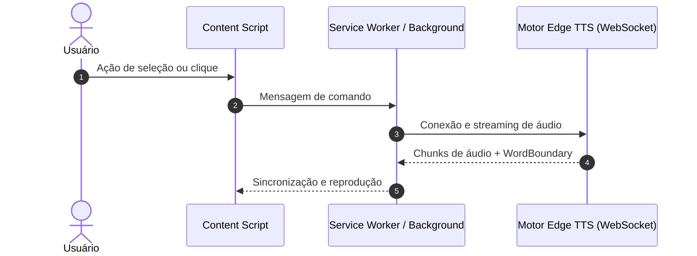

# Plano de Implementação: [Nome da Funcionalidade ou Módulo]

> **Status:** Em Planejamento  
> **Data de Criação:** [AAAA-MM-DD]  
> **Arquivo Alvo:** `.metadocs/implementation_plan/[nome_da_feature].md`  
> **Stack & Regras Aplicadas:** JavaScript/TypeScript (Chromium Manifest V3) | `.agents/rules/code.md` | `.agents/rules/javascript.md`

---

## 1. Visão Geral e Contexto de Negócio

### 1.1 Objetivo Técnico
[Descrição direta, sem rodeios ou floreios, do que esta entrega constrói e qual dor técnica/funcional ela resolve].

### 1.2 O Pilar "Por que?" (Racional Arquitetural e Decisões de Projeto)
- **Problema a Resolver:** [Por que esta funcionalidade/módulo é necessário?]
- **Alternativas Consideradas vs. Escolha Adotada:**
  - *Opção A (Descartada):* [Explicar por que não foi escolhida e quais limitações apresentava].
  - *Opção B (Escolhida):* [Justificar por que é a melhor escolha técnica em termos de performance, segurança, compatibilidade e manutenção].
- **Trade-offs Técnicos:** [Quais concessões foram feitas (ex.: complexidade de código vs. latência zero, uso de memória vs. velocidade de resposta)].
- **Alinhamento com Diretrizes de Engenharia:** [Como a solução adere ao Clean Code, separação de responsabilidades (SRP) e regras do repositório].

---

## 2. Diagramas de Arquitetura e Fluxo de Execução



---

## 3. Mapeamento Estrutural de Arquivos

| Ação | Caminho do Arquivo | Responsabilidade Única (SRP) |
|---|---|---|
| `Criar` / `Modificar` | `src/caminho/para/arquivo.js` | [Responsabilidade clara do arquivo] |

---

## 4. Especificação Técnica Detalhada por Módulo (O "Como?" e o "Por que?")

### 4.1 Módulo: `src/[diretorio]/[nome_do_arquivo].js`

#### 4.1.1 O "Por que?" Deste Módulo
- **Motivação:** [Por que este módulo existe de forma isolada? Qual o ganho de modularidade e testabilidade?]
- **Decisão Técnica Específica:** [Por que usamos determinado padrão de projeto (ex.: Factory, Singleton, Observer, Strategy) ou API do navegador?]

#### 4.1.2 O "Como?" Técnico (Contratos, Assinaturas e Estruturas)
- **Assinaturas Completas de Classes, Interfaces e Métodos:**
```javascript
/**
 * Descrição expressiva da classe ou função.
 */
export class ExemploDeClasse {
  /**
   * @param {string} parametroDescritivo - Explicação do parâmetro sem abreviações.
   * @param {Object} configuracao - Objeto de configuração.
   * @returns {Promise<boolean>} Resultado da operação.
   */
  async executarAcaoEspecifica(parametroDescritivo, configuracao) {
    // Código ou fluxo estruturado
  }
}
```

- **Esquema de Dados e Mensagens (Payloads):**
```json
{
  "tipoMensagem": "COMANDO_ESPECIFICO",
  "payload": {
    "identificador": "string",
    "valorTaxa": 1.0
  }
}
```

- **Algoritmo Passo a Passo (Zero Ambiguidade para Execução por LLM):**
  1. **Passo 1 (Validação e Guard Clauses):** [Checagem de parâmetros de entrada. Se inválido, lançar exceção explícita ou retornar falha controlada].
  2. **Passo 2 (Preparação de Estado):** [Instanciação de objetos, configuração de listeners ou alocação de buffers].
  3. **Passo 3 (Processamento Principal):** [Execução da lógica central, comunicação assíncrona, conversão de dados].
  4. **Passo 4 (Disparo de Eventos / Retorno):** [Atualização de estado, emissão de mensagens ou resolução de Promise].
  5. **Passo 5 (Limpeza e Gerenciamento de Memória):** [Remoção de listeners, liberação de buffers ou cancelamento de timers].

---

## 5. Tratamento de Casos de Borda, Falhas e Recuperação

| Cenário de Falha / Borda | O "Como?" (Mecanismo de Recuperação) | O "Por que?" (Racional da Solução) |
|---|---|---|
| Perda de conexão de rede / WebSocket | Reconexão exponencial com limite de 3 tentativas e fallback transparente para Web Speech API | Garante continuidade da leitura sem travar a interface do usuário |
| Hibernação do Service Worker durante áudio longo | Port ativo com `chrome.runtime.connect` e offscreen document | Cumpre as restrições rígidas do Manifest V3 sem interrupção de reprodução |
| Seleção de texto contendo quebras ou caracteres especiais | Normalização regex com preservação de pontuação lógica para chunking | Evita erros de sintaxe no sintetizador SSML e pausas artificiais |

---

## 6. Critérios de Aceite e Roteiro de Verificação

### 6.1 Critérios de Aceite Funcionais e Técnicos
- [ ] **Critério 1:** [Condição de sucesso verificável objetivamente].
- [ ] **Critério 2:** [Sem mutação de tags no DOM hospedeiro, validado via DevTools].
- [ ] **Critério 3:** [Transição entre sentenças consecutivas com latência inferior a 50ms].
- [ ] **Critério 4:** [Nenhum erro ou warning não tratado no console].

### 6.2 Passos Manuais de Validação
1. Abrir a página de teste no Microsoft Edge e no Brave.
2. Executar o fluxo passo a passo: [Ação exata a realizar].
3. Observar o comportamento no console e na UI: [Resultado esperado].
4. Testar o caso de interrupção (ex.: pressionar `Esc` ou fechar a aba): [Resultado esperado].
