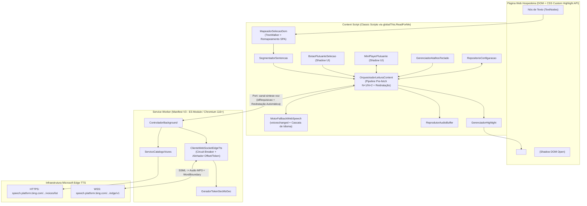
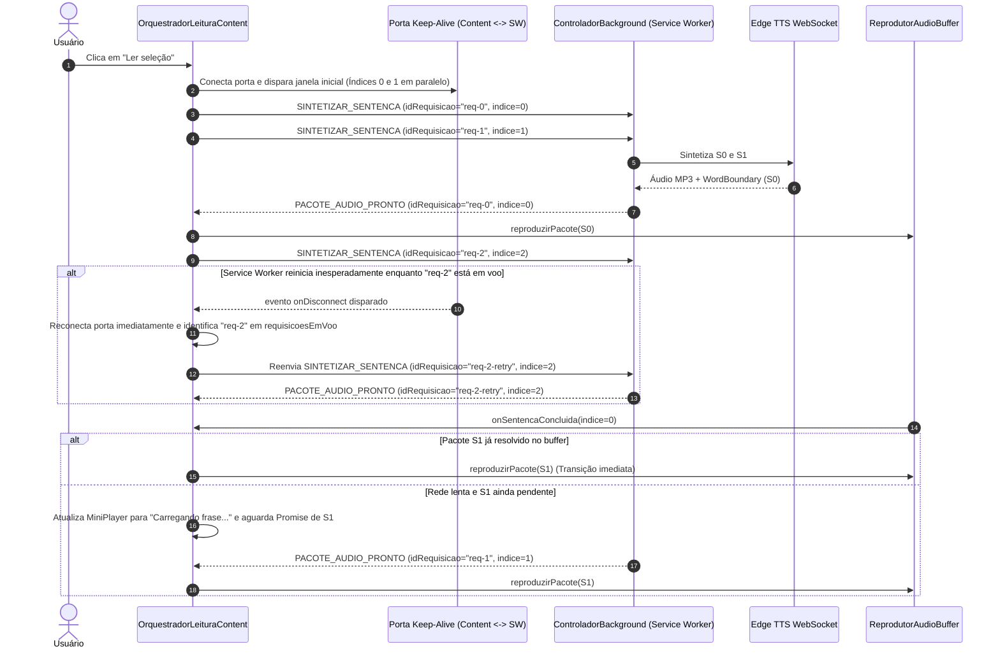

# Plano de Implementação: Extensão Read For Me (Text-to-Speech Manifest V3)

> **Status:** Em Planejamento (Revisado — Bloqueadores e Riscos Mitigados)
>
> **Data de Criação:** 2026-10-17
>
> **Última Revisão:** 2026-10-18
>
> **Arquivo Alvo:** `.metadocs/implementation_plan/extensao_tts_completa.md`
>
> **Stack & Regras Aplicadas:** JavaScript Moderno (ES2022+) | Chromium Manifest V3 (Chromium 116+) | CSS Custom Highlight API | Shadow DOM | WebSocket Edge TTS | Vitest | `.agents/rules/language.md` | `.agents/rules/code.md` | `.agents/rules/javascript.md`

---

## 1. Visão Geral e Contexto de Negócio

### 1.1 Objetivo Técnico
Projetar e especificar deterministicamente a arquitetura completa da extensão **Read For Me** para navegadores baseados em Chromium (**Microsoft Edge** e **Brave**, versão mínima **Chromium 116**) sobre a especificação **Manifest V3**. O sistema realiza leitura de textos selecionados com vozes neurais naturais (`Microsoft Natural Online`) via protocolo WebSocket direto com o endpoint Edge TTS (`speech.platform.bing.com`), fallback resiliente para `window.speechSynthesis` com resolução assíncrona de vozes locais, bufferização antecipada em janela deslizante (*Audio Pre-fetching* de `N+1` e `N+2`), sincronização visual não-destrutiva de frase e palavra via **CSS Custom Highlight API** (`CSS.highlights`) e interface flutuante arrastável encapsulada em **Shadow DOM**.

### 1.2 O Pilar "Por que?" (Racional Arquitetural e Decisões de Projeto)

- **Problema a Resolver:**
  1. **Assimetria de Vozes entre Edge e Brave:** O navegador Brave não expõe nativamente as vozes neurais online da Microsoft na API `window.speechSynthesis`, restringindo o usuário a vozes locais sintetizadas pelo sistema operacional.
  2. **Cortes, Timeouts e Latência entre Frases:** Sintetizar blocos longos de uma só vez provoca desconexões por timeout, atraso inicial elevado (*Time-To-First-Audio*) e interrupções pelo encerramento do Service Worker no Manifest V3.
  3. **Corrupção de DOM em Aplicações Modernas (SPAs):** Envolver palavras da página em tags `<span>` ou `<mark>` quebra a reconciliação de *Virtual DOM* em React, Vue e Angular e causa *reflows* síncronos a cada palavra pronunciada.
  4. **Vazamento de Estilos CSS:** Componentes injetados diretamente no DOM sofrem interferência de folhas de estilo globais da página hospedeira.

- **Alternativas Consideradas vs. Escolha Adotada:**
  - *Motor de Síntese de Voz e Contingência:*
    - **Opção A (Descartada):** Uso exclusivo de `window.speechSynthesis`. Descartada como motor primário porque o Brave não possui as vozes neurais da Microsoft.
    - **Opção B (Escolhida):** Cliente WebSocket direto para o protocolo `speech.platform.bing.com` no Service Worker com **Disjuntor (*Circuit Breaker*)** de falhas e fallback automático para `window.speechSynthesis` (com espera assíncrona do evento `voiceschanged` e cascata de seleção de voz local por idioma `pt-BR` -> `pt` -> padrão do sistema).
  - *Compatibilidade de Versão e Ciclo de Vida no Manifest V3:*
    - **Opção A (Descartada):** Declarar `minimum_chrome_version: "105"`. Descartada porque, embora `CSS.highlights` exista desde o Chromium 105, o suporte nativo para que conexões `WebSocket` ativas mantenham o Service Worker vivo só foi introduzido no **Chromium 116**.
    - **Opção B (Escolhida):** Exigir `"minimum_chrome_version": "116"`, combinar atividade de WebSocket com porta persistente (`chrome.runtime.Port`) + *heartbeat* a cada 20 segundos, e implementar protocolo completo de **reidratação e reenvio de requisições em voo** no Content Script caso o Service Worker seja reiniciado pelo navegador.
  - *Estratégia de Módulos entre Service Worker, Content Script e Testes (Vitest):*
    - **Opção A (Descartada):** Usar a palavra-chave `export` em arquivos carregados diretamente em `content_scripts.js`. Descartada porque `content_scripts` no Manifest V3 executam como *Classic Scripts* e lançam `SyntaxError: Unexpected token 'export'`.
    - **Opção B (Escolhida):** Separação clara de fronteira de execução sem exigir *bundler* obrigatório para `Load unpacked`:
      1. Todos os arquivos de `src/shared/` e `src/content/` são escritos como *Classic Scripts* compatíveis com IIFE/UMD leve: registram seus módulos em `globalThis.ReadForMe` (para o Content Script e para importação por efeito colateral no Service Worker) e exportam via `if (typeof module !== 'undefined' && module.exports)` para execução direta no **Vitest**. Nenhum arquivo listado em `content_scripts.js` contém `import` ou `export` top-level.
      2. Os arquivos exclusivos de `src/background/` rodam no Service Worker (`"type": "module"`), importam `src/shared/` por efeito colateral (`import '../shared/constantes_sistema.js';`) lendo de `globalThis.ReadForMe`, e usam `export` ES6 normalmente entre si.
  - *Privacidade e Escopo de Injeção:*
    - **Decisão Adotada:** Injetar apenas em esquemas `https://*/*` e `http://*/*` (nunca `<all_urls>`), bloquear ativação em campos `input[type="password"]` ou elementos sensíveis, e **jamais enviar texto para a rede no evento de seleção** (`mouseup`). Antes da primeira síntese remota, o Mini-Player informa que o texto selecionado será enviado ao serviço da Microsoft e oferece as ações `Usar voz natural`, `Usar voz local` e `Cancelar`; a decisão remota é persistida em `chrome.storage.local` e pode ser revista pelo usuário.

---

## 2. Diagramas de Arquitetura e Fluxo de Execução

### 2.1 Diagrama de Componentes da Arquitetura



### 2.2 Diagrama de Sequência: Pipeline Pre-fetching (N, N+1, N+2) e Recuperação de Queda do Service Worker



---

## 3. Mapeamento Estrutural de Arquivos

| Ação | Caminho do Arquivo | Responsabilidade Única (SRP) |
|---|---|---|
| `Criar` | `package.json` | Configuração de scripts de teste (`npm test` com Vitest e `jsdom`) e lint, mantendo zero dependências de runtime na extensão. |
| `Criar` | `manifest.json` | Manifesto V3 (`minimum_chrome_version: "116"`), `host_permissions` válidas (`https://speech.platform.bing.com/*`), Service Worker e Content Scripts. |
| `Criar` | `assets/icons/icon-16.png` | Ícone da extensão 16x16px. |
| `Criar` | `assets/icons/icon-48.png` | Ícone da extensão 48x48px. |
| `Criar` | `assets/icons/icon-128.png` | Ícone da extensão 128x128px. |
| `Criar` | `src/shared/constantes_sistema.js` | Constantes globais registradas em `globalThis.ReadForMe.CONSTANTES_SISTEMA` (compatível com Classic Script, ESM side-effect e CommonJS/Vitest). |
| `Criar` | `src/shared/utilitarios_texto.js` | Sanitização SSML com mapa bidirecional de offsets, extração dinâmica de versão do Chromium, geração de UUID hex e alinhamento determinístico de `WordBoundary`. |
| `Criar` | `src/background/gerador_token_sec_ms_gec.js` | Geração do token SHA-256 `Sec-MS-GEC` sobre Windows FileTime ticks (ES Module). |
| `Criar` | `src/background/servico_catalogo_vozes.js` | Busca, priorização (`pt-BR` e `en-US` no topo) e cache de 24h do catálogo de vozes Microsoft Natural (ES Module). |
| `Criar` | `src/background/cliente_websocket_edge_tts.js` | Cliente WebSocket para `speech.platform.bing.com` com *Circuit Breaker*, parser binário/metadados e alinhamento de offsets (ES Module). |
| `Criar` | `src/background/service_worker.js` | Entrada do Service Worker: menu de contexto, atalho `Alt+Shift+S`, portas de *keep-alive* e cancelamento por `idRequisicao`/`idSessaoLeitura`. |
| `Criar` | `src/content/configuracao/repositorio_configuracao.js` | Persistência e sincronização reativa em `chrome.storage.local` (Classic Script em `globalThis.ReadForMe`). |
| `Criar` | `src/content/dom/segmentador_sentencas.js` | *Sentence Chunking* com `Intl.Segmenter`, proteção de abreviações em `pt-BR`/`en-US` e subdivisão de cláusulas longas. |
| `Criar` | `src/content/dom/mapeador_selecao_dom.js` | Varredura de `Selection` via `TreeWalker`, criação de múltiplos `Range`s e remapeamento resiliente caso uma SPA re-renderize o DOM. |
| `Criar` | `src/content/destaque/estilos_highlight.css` | Regras globais `::highlight(leitura-frase-ativa)` e `::highlight(leitura-palavra-ativa)`. |
| `Criar` | `src/content/destaque/gerenciador_highlight.js` | Controlador da **CSS Custom Highlight API** (`CSS.highlights`) com auto-scroll suave na viewport. |
| `Criar` | `src/content/audio/reprodutor_audio_buffer.js` | Reprodutor `HTMLAudioElement` em memória com sincronização de `WordBoundary` em `requestAnimationFrame` e ajuste instantâneo de `playbackRate`. |
| `Criar` | `src/content/audio/motor_fallback_web_speech.js` | Fallback `window.speechSynthesis` com espera assíncrona de `voiceschanged` e seleção em cascata de voz local equivalente. |
| `Criar` | `src/content/ui/estilos_shadow_ui.js` | CSS isolado para Shadow DOM (Glassmorphism / Dark Mode elegante). |
| `Criar` | `src/content/ui/botao_flutuante_selecao.js` | Botão discreto próximo à seleção dentro do Shadow DOM (com bloqueio em campos de senha). |
| `Criar` | `src/content/ui/mini_player_flutuante.js` | Mini-Player arrastável no Shadow DOM com controles de reprodução, velocidade, filtro de idioma, seletor de voz e indicador de status/modo. |
| `Criar` | `src/content/atalhos/gerenciador_atalhos_teclado.js` | Tratamento de `Espaço` (quando focado no Shadow DOM), `Alt+Shift+S` e `Esc`. |
| `Criar` | `src/content/orquestrador_leitura_content.js` | Máquina de estados central, buffer deslizante (`N+1`, `N+2`) e reidratação automática de requisições quando o Service Worker reinicia. |
| `Criar` | `tests/utilitarios_texto.test.js` | Testes unitários de sanitização SSML, mapa de offsets e alinhamento de `WordBoundary` com palavras repetidas, números e entidades XML. |
| `Criar` | `tests/segmentador_sentencas.test.js` | Testes unitários de *Sentence Chunking*, abreviações (`Dr.`, `Sr.`, `etc.`) e preservação de offsets globais. |
| `Criar` | `tests/mapeador_selecao_dom.test.js` | Testes unitários de criação de `Range`s atravessando múltiplas tags inline e remapeamento após re-renderização de SPA. |
| `Criar` | `tests/cliente_websocket_edge_tts.test.js` | Testes de integração com WebSocket simulado (frames binários MP3, `Path:audio.metadata`, `Path:turn.end`, timeout e *Circuit Breaker*). |

---

## 4. Especificação Técnica Detalhada por Módulo (O "Como?" e o "Por que?")

---

### 4.1 Módulo: `manifest.json`

#### 4.1.1 O "Por que?" Deste Módulo
- **Motivação:** Configurar o contrato da extensão no Chromium sem erros de validação de manifesto e com permissões de menor privilégio.
- **Decisões Técnicas Críticas (Correção de Bloqueadores):**
   1. **Remoção de `wss://` em `host_permissions`:** A especificação de *Match Patterns* do Chrome/Chromium aceita apenas `http://`, `https://`, `file://` ou `ftp://`. Declarar `wss://...` impede o carregamento do manifesto. A permissão `"https://speech.platform.bing.com/*"` é usada para buscar o catálogo HTTPS; a conexão WebSocket é verificada em testes de integração no Edge e no Brave.
  2. **`minimum_chrome_version: "116"`:** O Chromium 116 introduziu o prolongamento automático de vida de Service Workers enquanto uma instância `WebSocket` estiver ativa trocando mensagens, além de já suportar nativamente `CSS.highlights` e `Intl.Segmenter`.
  3. **Restrição de Escopo de `content_scripts.matches`:** Uso de `["https://*/*", "http://*/*"]` em vez de `<all_urls>`, evitando injeção desnecessária em arquivos locais `file://` ou esquemas especiais.

#### 4.1.2 O "Como?" Técnico (Código Completo do `manifest.json`)
```json
{
  "manifest_version": 3,
  "name": "Read For Me — Leitor Neural de Alta Performance",
  "short_name": "Read For Me",
  "version": "1.0.0",
  "description": "Leitura fluida de textos selecionados com vozes Microsoft Natural Online, highlight não-destrutivo e mini-player em Shadow DOM para Edge e Brave.",
  "minimum_chrome_version": "116",
  "icons": {
    "16": "assets/icons/icon-16.png",
    "48": "assets/icons/icon-48.png",
    "128": "assets/icons/icon-128.png"
  },
  "permissions": [
    "contextMenus",
    "storage"
  ],
  "host_permissions": [
    "https://speech.platform.bing.com/*"
  ],
  "background": {
    "service_worker": "src/background/service_worker.js",
    "type": "module"
  },
  "commands": {
    "alternar-pausa-leitura": {
      "suggested_key": {
        "default": "Alt+Shift+S"
      },
      "description": "Pausar ou retomar a leitura atual"
    }
  },
  "content_scripts": [
    {
      "matches": [
        "https://*/*",
        "http://*/*"
      ],
      "css": [
        "src/content/destaque/estilos_highlight.css"
      ],
      "js": [
        "src/shared/constantes_sistema.js",
        "src/shared/utilitarios_texto.js",
        "src/content/configuracao/repositorio_configuracao.js",
        "src/content/dom/segmentador_sentencas.js",
        "src/content/dom/mapeador_selecao_dom.js",
        "src/content/destaque/gerenciador_highlight.js",
        "src/content/audio/reprodutor_audio_buffer.js",
        "src/content/audio/motor_fallback_web_speech.js",
        "src/content/ui/estilos_shadow_ui.js",
        "src/content/ui/botao_flutuante_selecao.js",
        "src/content/ui/mini_player_flutuante.js",
        "src/content/atalhos/gerenciador_atalhos_teclado.js",
        "src/content/orquestrador_leitura_content.js"
      ],
      "run_at": "document_idle",
      "all_frames": false
    }
  ]
}
```

---

### 4.2 Módulo: `src/shared/constantes_sistema.js` e `src/shared/utilitarios_texto.js`

#### 4.2.1 O "Por que?" Destes Módulos
- **Motivação:** Compartilhar constantes de protocolo e algoritmos puros de manipulação de texto/SSML entre Service Worker, Content Script e suíte de testes Vitest **sem conflito entre ES Modules e Classic Scripts**.
- **Decisão Técnica Específica:**
  - Nenhum arquivo em `src/shared/` utiliza a palavra-chave `export` top-level. Em vez disso, cada arquivo executa uma IIFE que popula `globalThis.ReadForMe` e, se `typeof module !== 'undefined' && module.exports` existir (ambiente Node/Vitest), também exporta via `module.exports`.
  - No Service Worker (`"type": "module"`), basta executar `import '../shared/constantes_sistema.js';` e ler `const { CONSTANTES_SISTEMA } = globalThis.ReadForMe;`.
  - **Alinhamento Determinístico de `WordBoundary` (`alinharPalavraAoTextoOriginal`):**
    - Resolve a falha funcional de palavras repetidas, números, pontuação e entidades XML (`&amp;`, `&lt;`, `&gt;`, `&quot;`, `&apos;`) combinando duas fontes de verdade:
      1. **Mapeamento Direto por Offset SSML:** `escaparTextoParaSsmlComMapa` retorna `mapaIndiceSsmlParaOriginal` (onde cada posição da string escapada aponta para o índice exato na string original da sentença) e `construirEnvelopeSsml` retorna `comprimentoPrefixoSsml` (o tamanho exato de `<speak...><voice...><prosody...>`). Se o metadado `WordBoundary` fornecer `TextOffset` (relativo ao SSML ou relativo ao texto interno), calculamos o índice original candidato diretamente pela tabela!
      2. **Busca Tokenizada por Fronteira Unicode com Cursor Progressivo:** Para blindar contra variações onde o servidor omite `TextOffset` ou aplica normalização, tokenizamos a sentença original com a expressão regular Unicode `/[\p{L}\p{N}]+(?:['’-][\p{L}\p{N}]+)*/gu` e localizamos o token completo a partir do `cursorBuscaCaractere` (jamais casando uma letra isolada `"a"` ou `"o"` no meio de outra palavra como `"roupa"`).

#### 4.2.2 O "Como?" Técnico (Código Completo e Determinístico)
```javascript
(function inicializarUtilitariosTexto(escopoGlobal) {
  escopoGlobal.ReadForMe = escopoGlobal.ReadForMe || {};

  /**
   * Extrai dinamicamente a versão do Chromium do User-Agent atual ou retorna versão estável de fallback.
   * @param {string} [userAgentNavegador] - String navigator.userAgent.
   * @param {string} [versaoPadraoFallback='130.0.2849.68'] - Versão usada caso não detectada.
   * @returns {string} Versão completa no formato 'MAJOR.0.BUILD.PATCH'.
   */
  function obterVersaoChromiumDinamica(
    userAgentNavegador = typeof navigator !== 'undefined' ? navigator.userAgent : '',
    versaoPadraoFallback = '130.0.2849.68'
  ) {
    const correspondenciaEdg = userAgentNavegador.match(/Edg\/(\d+\.\d+\.\d+\.\d+)/);
    if (correspondenciaEdg && correspondenciaEdg[1]) {
      return correspondenciaEdg[1];
    }
    const correspondenciaChrome = userAgentNavegador.match(/Chrom(?:e|ium)\/(\d+\.\d+\.\d+\.\d+)/);
    if (correspondenciaChrome && correspondenciaChrome[1]) {
      return correspondenciaChrome[1];
    }
    return versaoPadraoFallback;
  }

  /**
   * Gera um identificador hexadecimal criptograficamente seguro de 32 caracteres sem hífens.
   * @returns {string} Identificador hexadecimal minúsculo.
   */
  function gerarIdentificadorConexaoHex() {
    const bytesAleatorios = new Uint8Array(16);
    crypto.getRandomValues(bytesAleatorios);
    return Array.from(bytesAleatorios, (byteAtual) =>
      byteAtual.toString(16).padStart(2, '0')
    ).join('');
  }

  /**
   * Escapa caracteres especiais XML (&, <, >, ", ') mantendo mapa exato de cada posição escapada
   * para o índice correspondente na string original não escapada.
   * @param {string} textoOriginal - Texto puro da sentença.
   * @returns {{ textoEscapado: string, mapaIndiceEscapadoParaOriginal: number[] }}
   */
  function escaparTextoParaSsmlComMapa(textoOriginal) {
    const tabelaSubstituicaoXml = {
      '&': '&amp;',
      '<': '&lt;',
      '>': '&gt;',
      '"': '&quot;',
      "'": '&apos;'
    };
    let textoEscapado = '';
    const mapaIndiceEscapadoParaOriginal = [];

    for (let indiceOriginal = 0; indiceOriginal < textoOriginal.length; indiceOriginal += 1) {
      const caractereAtual = textoOriginal[indiceOriginal];
      const entidadeSubstituta = tabelaSubstituicaoXml[caractereAtual];

      if (entidadeSubstituta) {
        textoEscapado += entidadeSubstituta;
        for (let indiceEntidade = 0; indiceEntidade < entidadeSubstituta.length; indiceEntidade += 1) {
          mapaIndiceEscapadoParaOriginal.push(indiceOriginal);
        }
      } else {
        textoEscapado += caractereAtual;
        mapaIndiceEscapadoParaOriginal.push(indiceOriginal);
      }
    }

    mapaIndiceEscapadoParaOriginal.push(textoOriginal.length);
    return { textoEscapado, mapaIndiceEscapadoParaOriginal };
  }

  /**
   * Constrói o envelope SSML e informa o deslocamento exato onde o texto escapado começa.
   * @param {string} textoOriginal - Texto puro da sentença.
   * @param {string} nomeVoz - Nome curto da voz (ex.: 'pt-BR-FranciscaNeural').
   * @param {string} idiomaVoz - Código de idioma (ex.: 'pt-BR').
   * @returns {{ envelopeSsml: string, comprimentoPrefixoSsml: number, mapaIndiceEscapadoParaOriginal: number[] }}
   */
  function construirEnvelopeSsmlMapeado(textoOriginal, nomeVoz, idiomaVoz) {
    const { textoEscapado, mapaIndiceEscapadoParaOriginal } =
      escaparTextoParaSsmlComMapa(textoOriginal);
    const prefixoSsml =
      `<speak version='1.0' xmlns='http://www.w3.org/2001/10/synthesis' xml:lang='${idiomaVoz}'>` +
      `<voice name='${nomeVoz}'>` +
      `<prosody pitch='+0Hz' rate='+0%' volume='+0%'>`;
    const sufixoSsml = `</prosody></voice></speak>`;

    return {
      envelopeSsml: `${prefixoSsml}${textoEscapado}${sufixoSsml}`,
      comprimentoPrefixoSsml: prefixoSsml.length,
      mapaIndiceEscapadoParaOriginal
    };
  }

  /**
   * Localiza com precisão a posição inicial e o comprimento da palavra falada na sentença original.
   * Combina o TextOffset do protocolo SSML (quando presente) com busca por fronteira de token Unicode.
   * @param {Object} parametrosAlinhamento
   * @param {string} parametrosAlinhamento.textoSentencaOriginal - Sentença original no DOM.
   * @param {string} parametrosAlinhamento.textoPalavraEvento - Palavra reportada no WordBoundary.
   * @param {number} [parametrosAlinhamento.offsetTextoEvento] - TextOffset bruto vindo no JSON do Edge TTS.
   * @param {number} parametrosAlinhamento.comprimentoPrefixoSsml - Tamanho do prefixo XML antes do texto.
   * @param {number[]} parametrosAlinhamento.mapaIndiceEscapadoParaOriginal - Mapa de índices SSML -> Original.
   * @param {number} parametrosAlinhamento.cursorBuscaCaractere - Posição mínima no texto original já alcançada.
   * @returns {{ indiceInicialCaractere: number, comprimentoPalavra: number, novoCursorBusca: number }}
   */
  function alinharPalavraAoTextoOriginal({
    textoSentencaOriginal,
    textoPalavraEvento,
    offsetTextoEvento,
    comprimentoPrefixoSsml,
    mapaIndiceEscapadoParaOriginal,
    cursorBuscaCaractere
  }) {
    const palavraLimpa = String(textoPalavraEvento || '').trim();
    if (!palavraLimpa) {
      return {
        indiceInicialCaractere: cursorBuscaCaractere,
        comprimentoPalavra: 0,
        novoCursorBusca: cursorBuscaCaractere
      };
    }

    // 1. Tentativa primária via TextOffset mapeado da entidade SSML para o texto original
    if (
      typeof offsetTextoEvento === 'number' &&
      offsetTextoEvento >= comprimentoPrefixoSsml
    ) {
      const indiceNoTextoEscapado = offsetTextoEvento - comprimentoPrefixoSsml;
      if (
        indiceNoTextoEscapado >= 0 &&
        indiceNoTextoEscapado < mapaIndiceEscapadoParaOriginal.length
      ) {
        const indiceOriginalMapeado = mapaIndiceEscapadoParaOriginal[indiceNoTextoEscapado];
        const fatiaCandidata = textoSentencaOriginal.slice(
          indiceOriginalMapeado,
          indiceOriginalMapeado + palavraLimpa.length
        );
        if (
          indiceOriginalMapeado >= cursorBuscaCaractere &&
          fatiaCandidata.localeCompare(palavraLimpa, undefined, { sensitivity: 'base' }) === 0
        ) {
          return {
            indiceInicialCaractere: indiceOriginalMapeado,
            comprimentoPalavra: palavraLimpa.length,
            novoCursorBusca: indiceOriginalMapeado + palavraLimpa.length
          };
        }
      }
    }

    // 2. Busca por token completo respeitando fronteiras de palavras Unicode a partir do cursor
    const expressaoTokens = /[\p{L}\p{N}]+(?:['’-][\p{L}\p{N}]+)*/gu;
    expressaoTokens.lastIndex = Math.max(0, cursorBuscaCaractere);
    const palavraNormalizada = palavraLimpa.toLocaleLowerCase();
    let correspondenciaToken = expressaoTokens.exec(textoSentencaOriginal);

    while (correspondenciaToken !== null) {
      const tokenEncontrado = correspondenciaToken[0];
      const indiceToken = correspondenciaToken.index;

      if (tokenEncontrado.toLocaleLowerCase() === palavraNormalizada) {
        return {
          indiceInicialCaractere: indiceToken,
          comprimentoPalavra: tokenEncontrado.length,
          novoCursorBusca: indiceToken + tokenEncontrado.length
        };
      }
      correspondenciaToken = expressaoTokens.exec(textoSentencaOriginal);
    }

    // 3. Fallback direto para símbolos/pontuações pronunciadas (ex.: "%", "$", "2026")
    const indiceSubcadeia = textoSentencaOriginal
      .toLocaleLowerCase()
      .indexOf(palavraNormalizada, Math.max(0, cursorBuscaCaractere));

    if (indiceSubcadeia !== -1) {
      return {
        indiceInicialCaractere: indiceSubcadeia,
        comprimentoPalavra: palavraLimpa.length,
        novoCursorBusca: indiceSubcadeia + palavraLimpa.length
      };
    }

    return {
      indiceInicialCaractere: cursorBuscaCaractere,
      comprimentoPalavra: Math.min(
        palavraLimpa.length,
        Math.max(0, textoSentencaOriginal.length - cursorBuscaCaractere)
      ),
      novoCursorBusca: cursorBuscaCaractere
    };
  }

  const UtilitariosTexto = Object.freeze({
    obterVersaoChromiumDinamica,
    gerarIdentificadorConexaoHex,
    escaparTextoParaSsmlComMapa,
    construirEnvelopeSsmlMapeado,
    alinharPalavraAoTextoOriginal
  });

  escopoGlobal.ReadForMe.UtilitariosTexto = UtilitariosTexto;

  if (typeof module !== 'undefined' && module.exports) {
    module.exports = UtilitariosTexto;
  }
})(typeof globalThis !== 'undefined' ? globalThis : window);
```

---

### 4.3 Módulo: `src/background/cliente_websocket_edge_tts.js`

#### 4.3.1 O "Por que?" Deste Módulo
- **Motivação:** Isolar a comunicação WebSocket com `speech.platform.bing.com`, extrair chunks MP3 e metadados `WordBoundary`, e proteger a experiência do usuário com um **Disjuntor (*Circuit Breaker*)** caso a Microsoft altere o protocolo interno ou a rede bloqueie o endpoint.
- **Decisão Técnica Específica:**
  - Mantém `contagemFalhasConsecutivas` e `timestampReaberturaCircuito`. Se ocorrerem 2 falhas seguidas de conexão/protocolo, o disjuntor abre por 5 minutos (`300_000ms`), sinalizando instantaneamente `FALHA_SINTESE_USAR_FALLBACK` sem fazer o usuário esperar timeouts de 10 segundos a cada frase!
  - Utiliza `obterVersaoChromiumDinamica()` para construir `Sec-MS-GEC-Version`, reduzindo o risco de obsolescência de versão fixa.

#### 4.3.2 O "Como?" Técnico (Código Estrutural Completo)
```javascript
import '../shared/constantes_sistema.js';
import '../shared/utilitarios_texto.js';
import { GeradorTokenSecMsGec } from './gerador_token_sec_ms_gec.js';

const { CONSTANTES_SISTEMA, UtilitariosTexto } = globalThis.ReadForMe;

/**
 * Cliente WebSocket do Edge TTS com Circuit Breaker e alinhamento determinístico de WordBoundary.
 */
export class ClienteWebSocketEdgeTts {
  constructor() {
    this.contagemFalhasConsecutivas = 0;
    this.timestampFimCircuitoAberto = 0;
    this.DURATION_CIRCUITO_ABERTO_MS = 300000;
  }

  /**
   * Verifica se o Circuit Breaker está aberto devido a falhas repetidas no endpoint remoto.
   * @returns {boolean}
   */
  estaComCircuitoAberto() {
    if (this.timestampFimCircuitoAberto === 0) {
      return false;
    }
    if (Date.now() < this.timestampFimCircuitoAberto) {
      return true;
    }
    this.timestampFimCircuitoAberto = 0;
    this.contagemFalhasConsecutivas = 0;
    return false;
  }

  /**
   * Registra falha de comunicação e abre o disjuntor se atingir o limite tolerado.
   * @returns {void}
   */
  registrarFalhaEndpoint() {
    this.contagemFalhasConsecutivas += 1;
    if (this.contagemFalhasConsecutivas >= CONSTANTES_SISTEMA.MAXIMO_TENTATIVAS_WS) {
      this.timestampFimCircuitoAberto = Date.now() + this.DURATION_CIRCUITO_ABERTO_MS;
    }
  }

  /**
   * Sintetiza uma sentença via WebSocket com retry automático e alinhamento de offsets.
   * @param {Object} parametrosSintese
   * @param {string} parametrosSintese.textoSentenca
   * @param {string} parametrosSintese.nomeVoz
   * @param {AbortSignal} [parametrosSintese.sinalAborto]
   * @returns {Promise<{audioBase64: string, limitesPalavras: Array}>}
   */
  async sintetizarSentenca({ textoSentenca, nomeVoz, sinalAborto }) {
    if (!textoSentenca || !textoSentenca.trim()) {
      throw new Error('O texto da sentença para síntese não pode ser vazio.');
    }
    if (this.estaComCircuitoAberto()) {
      throw new Error('Circuito do Edge TTS temporariamente aberto; utilizar fallback local.');
    }

    let ultimoErroCapturado = null;
    for (
      let tentativaAtual = 1;
      tentativaAtual <= CONSTANTES_SISTEMA.MAXIMO_TENTATIVAS_WS;
      tentativaAtual += 1
    ) {
      if (sinalAborto && sinalAborto.aborted) {
        throw new Error('Síntese cancelada pelo AbortSignal.');
      }
      try {
        const resultadoSintese = await this.executarTransacaoWebSocketUnica({
          textoSentenca,
          nomeVoz,
          sinalAborto
        });
        this.contagemFalhasConsecutivas = 0;
        this.timestampFimCircuitoAberto = 0;
        return resultadoSintese;
      } catch (erroTentativa) {
        ultimoErroCapturado = erroTentativa;
        if (sinalAborto && sinalAborto.aborted) {
          throw erroTentativa;
        }
      }
    }

    this.registrarFalhaEndpoint();
    throw ultimoErroCapturado || new Error('Falha desconhecida ao sintetizar no Edge TTS.');
  }

  /**
   * Executa uma única transação completa no WebSocket do Edge TTS.
   * @param {Object} parametros
   * @returns {Promise<{audioBase64: string, limitesPalavras: Array}>}
   */
  async executarTransacaoWebSocketUnica({ textoSentenca, nomeVoz, sinalAborto }) {
    const idConexao = UtilitariosTexto.gerarIdentificadorConexaoHex();
    const idRequisicaoSsml = UtilitariosTexto.gerarIdentificadorConexaoHex();
    const versaoChromium = UtilitariosTexto.obterVersaoChromiumDinamica();
    const tokenSecMsGec = await GeradorTokenSecMsGec.gerarTokenSeguranca(
      CONSTANTES_SISTEMA.TOKEN_CLIENTE_CONFIAVEL_EDGE
    );

    const urlWebSocket =
      `${CONSTANTES_SISTEMA.URL_BASE_WEBSOCKET_EDGE}` +
      `?TrustedClientToken=${CONSTANTES_SISTEMA.TOKEN_CLIENTE_CONFIAVEL_EDGE}` +
      `&Sec-MS-GEC=${tokenSecMsGec}` +
      `&Sec-MS-GEC-Version=1-${versaoChromium}` +
      `&ConnectionId=${idConexao}`;

    const idiomaExtraido = (nomeVoz.match(/^[a-z]{2}-[A-Z]{2}/) || ['pt-BR'])[0];
    const {
      envelopeSsml,
      comprimentoPrefixoSsml,
      mapaIndiceEscapadoParaOriginal
    } = UtilitariosTexto.construirEnvelopeSsmlMapeado(textoSentenca, nomeVoz, idiomaExtraido);

    return new Promise((resolver, rejeitar) => {
      const partesAudioMp3 = [];
      const limitesPalavras = [];
      let cursorBuscaCaractere = 0;
      let transacaoFinalizada = false;

      const socket = new WebSocket(urlWebSocket);
      socket.binaryType = 'arraybuffer';

      const limparRecursos = () => {
        clearTimeout(idTimerTimeout);
        if (sinalAborto) {
          sinalAborto.removeEventListener('abort', aoAbortarRequisicao);
        }
        if (
          socket.readyState === WebSocket.OPEN ||
          socket.readyState === WebSocket.CONNECTING
        ) {
          socket.close(1000, 'Encerramento controlado');
        }
      };

      const aoAbortarRequisicao = () => {
        if (transacaoFinalizada) {
          return;
        }
        transacaoFinalizada = true;
        limparRecursos();
        rejeitar(new Error('Síntese abortada pelo controlador da sessão.'));
      };

      const idTimerTimeout = setTimeout(() => {
        if (transacaoFinalizada) {
          return;
        }
        transacaoFinalizada = true;
        limparRecursos();
        rejeitar(new Error('Tempo limite excedido na comunicação WebSocket com Edge TTS.'));
      }, CONSTANTES_SISTEMA.TIMEOUT_CONEXAO_WS_MS);

      if (sinalAborto) {
        sinalAborto.addEventListener('abort', aoAbortarRequisicao, { once: true });
      }

      socket.onopen = () => {
        const carimboTempo = new Date().toString();
        const quadroConfiguracao =
          `X-Timestamp:${carimboTempo}\r\n` +
          `Content-Type:application/json; charset=utf-8\r\n` +
          `Path:speech.config\r\n\r\n` +
          JSON.stringify({
            context: {
              synthesis: {
                audio: {
                  metadataoptions: {
                    sentenceBoundaryEnabled: 'false',
                    wordBoundaryEnabled: 'true'
                  },
                  outputFormat: CONSTANTES_SISTEMA.FORMATO_SAIDA_AUDIO
                }
              }
            }
          });

        const quadroSsml =
          `X-RequestId:${idRequisicaoSsml}\r\n` +
          `Content-Type:application/ssml+xml\r\n` +
           `X-Timestamp:${carimboTempo}\r\n` +
          `Path:ssml\r\n\r\n` +
          envelopeSsml;

        socket.send(quadroConfiguracao);
        socket.send(quadroSsml);
      };

      socket.onmessage = (eventoMensagem) => {
        if (transacaoFinalizada) {
          return;
        }

        if (typeof eventoMensagem.data === 'string') {
          const textoQuadro = eventoMensagem.data;
          if (textoQuadro.includes('Path:audio.metadata')) {
            const indiceSeparador = textoQuadro.indexOf('\r\n\r\n');
            if (indiceSeparador !== -1) {
              const corpoJson = JSON.parse(textoQuadro.slice(indiceSeparador + 4));
              const listaMetadados = Array.isArray(corpoJson.Metadata) ? corpoJson.Metadata : [];
              for (const itemMetadado of listaMetadados) {
                if (itemMetadado.Type === 'WordBoundary' && itemMetadado.Data) {
                  const dadosPalavra = itemMetadado.Data;
                  const objetoTexto = dadosPalavra.text || {};
                  const alinhamento = UtilitariosTexto.alinharPalavraAoTextoOriginal({
                    textoSentencaOriginal: textoSentenca,
                    textoPalavraEvento: objetoTexto.Text,
                    offsetTextoEvento:
                      typeof objetoTexto.TextOffset === 'number'
                        ? objetoTexto.TextOffset
                        : dadosPalavra.TextOffset,
                    comprimentoPrefixoSsml,
                    mapaIndiceEscapadoParaOriginal,
                    cursorBuscaCaractere
                  });
                  cursorBuscaCaractere = alinhamento.novoCursorBusca;
                  limitesPalavras.push({
                    tempoInicioSegundos: (dadosPalavra.Offset || 0) / 10000000,
                    duracaoSegundos: (dadosPalavra.Duration || 0) / 10000000,
                    textoPalavra: objetoTexto.Text || '',
                    indiceInicialCaractere: alinhamento.indiceInicialCaractere,
                    comprimentoPalavra: alinhamento.comprimentoPalavra
                  });
                }
              }
            }
          } else if (textoQuadro.includes('Path:turn.end')) {
            transacaoFinalizada = true;
            limparRecursos();
            const audioBase64 = ClienteWebSocketEdgeTts.concatenarBuffersParaBase64(partesAudioMp3);
            if (!audioBase64) {
              rejeitar(new Error('O servidor Edge TTS encerrou o turno sem enviar bytes de áudio.'));
              return;
            }
            resolver({ audioBase64, limitesPalavras });
          }
          return;
        }

        if (eventoMensagem.data instanceof ArrayBuffer) {
          const bufferQuadro = eventoMensagem.data;
          if (bufferQuadro.byteLength < 2) {
            return;
          }
          const visaoDados = new DataView(bufferQuadro);
          const tamanhoCabecalho = visaoDados.getUint16(0, false);
          if (bufferQuadro.byteLength <= 2 + tamanhoCabecalho) {
            return;
          }
          const cabecalhoTexto = new TextDecoder().decode(
            bufferQuadro.slice(2, 2 + tamanhoCabecalho)
          );
          if (cabecalhoTexto.includes('Path:audio')) {
            partesAudioMp3.push(new Uint8Array(bufferQuadro, 2 + tamanhoCabecalho));
          }
        }
      };

      socket.onerror = () => {
        if (transacaoFinalizada) {
          return;
        }
        transacaoFinalizada = true;
        limparRecursos();
        rejeitar(new Error('Erro de transporte no WebSocket do Edge TTS.'));
      };

      socket.onclose = (eventoFechamento) => {
        if (transacaoFinalizada) {
          return;
        }
        transacaoFinalizada = true;
        limparRecursos();
        rejeitar(
          new Error(
            `WebSocket do Edge TTS fechado prematuramente (código ${eventoFechamento.code}).`
          )
        );
      };
    });
  }

  /**
   * Concatena múltiplos Uint8Array de áudio MP3 e codifica em Base64.
   * @param {Uint8Array[]} listaPartesMp3
   * @returns {string}
   */
  static concatenarBuffersParaBase64(listaPartesMp3) {
    const tamanhoTotal = listaPartesMp3.reduce(
      (acumulado, parteAtual) => acumulado + parteAtual.byteLength,
      0
    );
    if (tamanhoTotal === 0) {
      return '';
    }
    const bufferUnificado = new Uint8Array(tamanhoTotal);
    let deslocamentoEscrita = 0;
    for (const parteAtual of listaPartesMp3) {
      bufferUnificado.set(parteAtual, deslocamentoEscrita);
      deslocamentoEscrita += parteAtual.byteLength;
    }

    const TAMANHO_BLOCO_STRING = 32768;
    let cadeiaBinaria = '';
    for (let indice = 0; indice < bufferUnificado.length; indice += TAMANHO_BLOCO_STRING) {
      const fatia = bufferUnificado.subarray(indice, indice + TAMANHO_BLOCO_STRING);
      cadeiaBinaria += String.fromCharCode.apply(null, fatia);
    }
    return btoa(cadeiaBinaria);
  }
}
```

---

### 4.4 Módulo: `src/content/dom/mapeador_selecao_dom.js` e `src/content/dom/segmentador_sentencas.js`

#### 4.4.1 O "Por que?" Destes Módulos
- **Motivação:** Transformar a seleção do usuário em sentenças lógicas (`Sentence Chunking`) e mapear qualquer intervalo `[inicioGlobal, fimGlobal]` em objetos `Range` nativos, **incluindo remapeamento resiliente caso uma SPA (React/Vue) re-renderize os nós de texto durante a leitura**.
- **Decisão Técnica Específica (Recuperação de Re-renderização em SPAs):**
  - Quando uma SPA atualiza o estado de um componente, os antigos `TextNode`s podem ser substituídos no DOM (`noTexto.isConnected === false`).
  - Em `criarRangesParaIntervaloGlobal(inicioGlobalAlvo, fimGlobalAlvo)`:
    1. Se todos os `TextNode`s do intervalo continuarem conectados (`isConnected === true`), fabrica os `Range`s diretamente em `O(1)`.
    2. Se algum `TextNode` tiver sido desconectado por re-renderização da SPA, invoca `reconstruirMapaNosNoContainerAncestral()`, que reexecuta o `TreeWalker` sobre o `elementoAncestralConectado` mais próximo e realinha os `TextNode`s atuais pelo texto da seleção.
    3. Caso o próprio container da página tenha deixado de existir (ex.: o usuário trocou de aba interna na SPA), retorna `[]` de forma silenciosa para que a leitura em áudio da frase continue sem quebrar e sem destacar nós fantasmas.

#### 4.4.2 O "Como?" Técnico (Código Estrutural Completo do Mapeador e Segmentador)
```javascript
(function inicializarMapeadorSelecaoDom(escopoGlobal) {
  escopoGlobal.ReadForMe = escopoGlobal.ReadForMe || {};

  const TAGS_BLOCO_HTML = new Set([
    'P', 'DIV', 'LI', 'UL', 'OL', 'H1', 'H2', 'H3', 'H4', 'H5', 'H6',
    'BLOCKQUOTE', 'PRE', 'TR', 'TD', 'TH', 'ARTICLE', 'SECTION', 'HEADER', 'FOOTER'
  ]);

  const TAGS_IGNORADAS = new Set(['SCRIPT', 'STYLE', 'NOSCRIPT', 'TEMPLATE']);

  class MapeadorSelecaoDom {
    /**
     * Verifica se o elemento atual está dentro de um campo sensível (ex.: senha).
     * @param {Node | null} noAlvo
     * @returns {boolean}
     */
    static estaEmCampoSensivel(noAlvo) {
      if (!noAlvo) {
        return false;
      }
      const elementoBase =
        noAlvo.nodeType === Node.ELEMENT_NODE ? noAlvo : noAlvo.parentElement;
      if (!elementoBase) {
        return false;
      }
      return Boolean(
        elementoBase.closest(
          'input[type="password"], [data-read-for-me-ignore="true"], #read-for-me-host-raiz'
        )
      );
    }

    /**
     * Captura a seleção atual do navegador e constrói o mapa completo de nós e sentenças.
     * @param {Selection} selecaoNavegador
     * @returns {Object | null}
     */
    static mapearSelecaoAtual(selecaoNavegador) {
      if (
        !selecaoNavegador ||
        selecaoNavegador.rangeCount === 0 ||
        selecaoNavegador.isCollapsed
      ) {
        return null;
      }

      const rangeOriginal = selecaoNavegador.getRangeAt(0).cloneRange();
      if (MapeadorSelecaoDom.estaEmCampoSensivel(rangeOriginal.commonAncestorContainer)) {
        return null;
      }

      const retanguloAncoraInicial = rangeOriginal.getBoundingClientRect();
      const elementoAncestralRaiz =
        rangeOriginal.commonAncestorContainer.nodeType === Node.ELEMENT_NODE
          ? rangeOriginal.commonAncestorContainer
          : rangeOriginal.commonAncestorContainer.parentElement;

      const dadosExtracao = MapeadorSelecaoDom.extrairSegmentosTextoDeRange(rangeOriginal);
      if (!dadosExtracao.textoCompleto.trim()) {
        return null;
      }

      const { SegmentadorSentencas } = escopoGlobal.ReadForMe;
      const sentencasMapeadas = SegmentadorSentencas.segmentarTextoEmSentencas(
        dadosExtracao.textoCompleto
      );
      if (sentencasMapeadas.length === 0) {
        return null;
      }

      let segmentosNosTextoAtuais = dadosExtracao.segmentosNosTexto;

      return {
        textoCompleto: dadosExtracao.textoCompleto,
        sentencasMapeadas,
        retanguloAncoraInicial,
        elementoAncestralRaiz,

        /**
         * Cria a lista de objetos Range para o intervalo global [inicioGlobalAlvo, fimGlobalAlvo].
         * Se uma SPA tiver re-renderizado os nós de texto, tenta remapear no ancestral conectado.
         * @param {number} inicioGlobalAlvo
         * @param {number} fimGlobalAlvo
         * @returns {Range[]}
         */
        criarRangesParaIntervaloGlobal(inicioGlobalAlvo, fimGlobalAlvo) {
          let segmentosCandidatos = segmentosNosTextoAtuais.filter(
            (segmento) =>
              segmento.fimGlobal > inicioGlobalAlvo &&
              segmento.inicioGlobal < fimGlobalAlvo
          );

          const algumNoDesconectado = segmentosCandidatos.some(
            (segmento) => !segmento.noTexto.isConnected
          );

          if (algumNoDesconectado && elementoAncestralRaiz && elementoAncestralRaiz.isConnected) {
            const remapeado = MapeadorSelecaoDom.remapearTextoEmElementoAncestral(
              elementoAncestralRaiz,
              dadosExtracao.textoCompleto
            );
            if (remapeado.length > 0) {
              segmentosNosTextoAtuais = remapeado;
              segmentosCandidatos = segmentosNosTextoAtuais.filter(
                (segmento) =>
                  segmento.fimGlobal > inicioGlobalAlvo &&
                  segmento.inicioGlobal < fimGlobalAlvo &&
                  segmento.noTexto.isConnected
              );
            }
          }

          const rangesGerados = [];
          for (const segmento of segmentosCandidatos) {
            if (!segmento.noTexto.isConnected) {
              continue;
            }
            const comprimentoSegmento = segmento.offsetFinalNoNo - segmento.offsetInicialNoNo;
            const deslocamentoRelativoInicio = Math.max(0, inicioGlobalAlvo - segmento.inicioGlobal);
            const deslocamentoRelativoFim = Math.min(
              comprimentoSegmento,
              fimGlobalAlvo - segmento.inicioGlobal
            );

            if (deslocamentoRelativoFim > deslocamentoRelativoInicio) {
              const novoRange = document.createRange();
              novoRange.setStart(
                segmento.noTexto,
                segmento.offsetInicialNoNo + deslocamentoRelativoInicio
              );
              novoRange.setEnd(
                segmento.noTexto,
                segmento.offsetInicialNoNo + deslocamentoRelativoFim
              );
              rangesGerados.push(novoRange);
            }
          }
          return rangesGerados;
        }
      };
    }

    /**
     * Extrai todos os TextNodes intersectados pelo Range e constrói o texto linear com offsets.
     * @param {Range} rangeSelecao
     * @returns {{ textoCompleto: string, segmentosNosTexto: Array }}
     */
    static extrairSegmentosTextoDeRange(rangeSelecao) {
      const segmentosNosTexto = [];
      let textoCompleto = '';
      let ultimoElementoBloco = null;

      const obterBlocoPai = (noTexto) => {
        let atual = noTexto.parentElement;
        while (atual && atual !== document.body) {
          if (TAGS_BLOCO_HTML.has(atual.tagName)) {
            return atual;
          }
          atual = atual.parentElement;
        }
        return document.body;
      };

      const registrarNoTexto = (noTexto) => {
        const elementoPai = noTexto.parentElement;
        if (!elementoPai || TAGS_IGNORADAS.has(elementoPai.tagName)) {
          return;
        }
        if (MapeadorSelecaoDom.estaEmCampoSensivel(elementoPai)) {
          return;
        }

        const offsetInicialNoNo =
          noTexto === rangeSelecao.startContainer ? rangeSelecao.startOffset : 0;
        const offsetFinalNoNo =
          noTexto === rangeSelecao.endContainer
            ? rangeSelecao.endOffset
            : noTexto.nodeValue.length;

        if (offsetFinalNoNo <= offsetInicialNoNo) {
          return;
        }

        const blocoAtual = obterBlocoPai(noTexto);
        if (
          ultimoElementoBloco !== null &&
          blocoAtual !== ultimoElementoBloco &&
          !textoCompleto.endsWith('\n')
        ) {
          textoCompleto += '\n';
        }
        ultimoElementoBloco = blocoAtual;

        const trechoTexto = noTexto.nodeValue.slice(offsetInicialNoNo, offsetFinalNoNo);
        const inicioGlobal = textoCompleto.length;
        textoCompleto += trechoTexto;
        const fimGlobal = textoCompleto.length;

        segmentosNosTexto.push({
          noTexto,
          offsetInicialNoNo,
          offsetFinalNoNo,
          inicioGlobal,
          fimGlobal
        });
      };

      if (rangeSelecao.commonAncestorContainer.nodeType === Node.TEXT_NODE) {
        registrarNoTexto(rangeSelecao.commonAncestorContainer);
      } else {
        const caminhanteArvore = document.createTreeWalker(
          rangeSelecao.commonAncestorContainer,
          NodeFilter.SHOW_TEXT,
          {
            acceptNode(noCandidato) {
              return rangeSelecao.intersectsNode(noCandidato)
                ? NodeFilter.FILTER_ACCEPT
                : NodeFilter.FILTER_REJECT;
            }
          }
        );
        let noAtual = caminhanteArvore.nextNode();
        while (noAtual) {
          registrarNoTexto(noAtual);
          noAtual = caminhanteArvore.nextNode();
        }
      }

      return { textoCompleto, segmentosNosTexto };
    }

    /**
     * Tenta reconstruir os segmentos de TextNodes após re-renderização de um componente SPA.
     * @param {Element} elementoAncestralRaiz
     * @param {string} textoOriginalEsperado
     * @returns {Array}
     */
    static remapearTextoEmElementoAncestral(elementoAncestralRaiz, textoOriginalEsperado) {
      const rangeInteiroAncestral = document.createRange();
      rangeInteiroAncestral.selectNodeContents(elementoAncestralRaiz);
      const extracaoAncestral = MapeadorSelecaoDom.extrairSegmentosTextoDeRange(
        rangeInteiroAncestral
      );
      const deslocamentoBase = extracaoAncestral.textoCompleto.indexOf(textoOriginalEsperado);
      if (deslocamentoBase === -1) {
        return [];
      }

      const fimBase = deslocamentoBase + textoOriginalEsperado.length;
      const novosSegmentos = [];
      for (const seg of extracaoAncestral.segmentosNosTexto) {
        if (seg.fimGlobal <= deslocamentoBase || seg.inicioGlobal >= fimBase) {
          continue;
        }
        const recorteInicio = Math.max(0, deslocamentoBase - seg.inicioGlobal);
        const recorteFim = Math.min(
          seg.offsetFinalNoNo - seg.offsetInicialNoNo,
          fimBase - seg.inicioGlobal
        );
        novosSegmentos.push({
          noTexto: seg.noTexto,
          offsetInicialNoNo: seg.offsetInicialNoNo + recorteInicio,
          offsetFinalNoNo: seg.offsetInicialNoNo + recorteFim,
          inicioGlobal: Math.max(0, seg.inicioGlobal - deslocamentoBase),
          fimGlobal: Math.min(textoOriginalEsperado.length, seg.fimGlobal - deslocamentoBase)
        });
      }
      return novosSegmentos;
    }
  }

  escopoGlobal.ReadForMe.MapeadorSelecaoDom = MapeadorSelecaoDom;
  if (typeof module !== 'undefined' && module.exports) {
    module.exports = MapeadorSelecaoDom;
  }
})(typeof globalThis !== 'undefined' ? globalThis : window);
```

---

### 4.5 Módulo: `src/content/audio/motor_fallback_web_speech.js`

#### 4.5.1 O "Por que?" Deste Módulo
- **Motivação:** Garantir que a leitura funcione com destaque visual mesmo quando o usuário estiver offline, quando o endpoint WebSocket estiver inacessível ou quando uma voz neural (`pt-BR-FranciscaNeural`) não existir no motor nativo `window.speechSynthesis`.
- **Decisão Técnica Específica (Resolução Assíncrona de Vozes Locais):**
  - No Chromium, `window.speechSynthesis.getVoices()` retorna um array vazio na primeira chamada até que o evento assíncrono `voiceschanged` seja emitido pelo processo do navegador.
  - `MotorFallbackWebSpeech.obterVozesLocaisProntas()` aguarda o evento `voiceschanged` (com timeout de segurança de `1500ms`) e aplica uma **cascata determinística de seleção de voz**:
    1. Correspondência pelo identificador curto ou nome da voz selecionada;
    2. Voz local do mesmo idioma/região (ex.: `pt-BR` ou `pt_BR`);
    3. Voz local da mesma família de idioma (ex.: `pt-*`);
    4. Voz padrão do sistema (`default === true`) com `utterance.lang = idiomaAlvo`.

#### 4.5.2 O "Como?" Técnico (Código Estrutural Completo do Fallback)
```javascript
(function inicializarMotorFallbackWebSpeech(escopoGlobal) {
  escopoGlobal.ReadForMe = escopoGlobal.ReadForMe || {};

  class MotorFallbackWebSpeech {
    constructor({ aoAtivarPalavra, aoConcluirSentenca, aoOcorrerErroAudio }) {
      this.aoAtivarPalavra = aoAtivarPalavra;
      this.aoConcluirSentenca = aoConcluirSentenca;
      this.aoOcorrerErroAudio = aoOcorrerErroAudio;
      this.velocidadeAtual = 1.0;
      this.enunciadoAtivo = null;
    }

    /**
     * Aguarda o carregamento assíncrono das vozes locais do navegador via voiceschanged.
     * @returns {Promise<SpeechSynthesisVoice[]>}
     */
    static async obterVozesLocaisProntas() {
      if (typeof window === 'undefined' || !('speechSynthesis' in window)) {
        return [];
      }
      const vozesImediatas = window.speechSynthesis.getVoices();
      if (vozesImediatas.length > 0) {
        return vozesImediatas;
      }

      return new Promise((resolver) => {
        const idTimer = setTimeout(() => {
          window.speechSynthesis.removeEventListener('voiceschanged', aoCarregarVozes);
          resolver(window.speechSynthesis.getVoices());
        }, 1500);

        function aoCarregarVozes() {
          clearTimeout(idTimer);
          window.speechSynthesis.removeEventListener('voiceschanged', aoCarregarVozes);
          resolver(window.speechSynthesis.getVoices());
        }

        window.speechSynthesis.addEventListener('voiceschanged', aoCarregarVozes);
      });
    }

    /**
     * Localiza a melhor voz local equivalente quando a voz neural online não existe no sistema.
     * @param {SpeechSynthesisVoice[]} listaVozesLocais
     * @param {string} nomeVozPreferida
     * @returns {{ vozEscolhida: SpeechSynthesisVoice | null, idiomaResolvido: string }}
     */
    static selecionarMelhorVozEquivalente(listaVozesLocais, nomeVozPreferida) {
      const idiomaAlvo = (String(nomeVozPreferida || '').match(/^[a-z]{2}-[A-Z]{2}/) || [
        'pt-BR'
      ])[0];
      const prefixoLingua = idiomaAlvo.split('-')[0].toLowerCase();
      const normalizarTag = (tag) => String(tag || '').replace('_', '-').toLowerCase();

      const correspondenciaExataNome = listaVozesLocais.find((voz) =>
        voz.name.toLowerCase().includes(String(nomeVozPreferida).toLowerCase())
      );
      if (correspondenciaExataNome) {
        return { vozEscolhida: correspondenciaExataNome, idiomaResolvido: idiomaAlvo };
      }

      const correspondenciaIdiomaRegiao = listaVozesLocais.find(
        (voz) => normalizarTag(voz.lang) === normalizarTag(idiomaAlvo)
      );
      if (correspondenciaIdiomaRegiao) {
        return { vozEscolhida: correspondenciaIdiomaRegiao, idiomaResolvido: idiomaAlvo };
      }

      const correspondenciaFamiliaLingua = listaVozesLocais.find((voz) =>
        normalizarTag(voz.lang).startsWith(prefixoLingua)
      );
      if (correspondenciaFamiliaLingua) {
        return {
          vozEscolhida: correspondenciaFamiliaLingua,
          idiomaResolvido: correspondenciaFamiliaLingua.lang
        };
      }

      const vozPadraoSistema = listaVozesLocais.find((voz) => voz.default) || listaVozesLocais[0] || null;
      return { vozEscolhida: vozPadraoSistema, idiomaResolvido: idiomaAlvo };
    }

    /**
     * Reproduz uma sentença usando window.speechSynthesis e emite WordBoundary via onboundary.
     * @param {string} textoSentenca
     * @param {string} nomeVozPreferida
     * @param {number} velocidadeReproducao
     * @returns {Promise<void>}
     */
    async reproduzirSentencaFallback(textoSentenca, nomeVozPreferida, velocidadeReproducao) {
      if (typeof window === 'undefined' || !('speechSynthesis' in window)) {
        this.aoOcorrerErroAudio(new Error('Web Speech API indisponível neste navegador.'));
        return;
      }

      this.pararELimpar();
      this.velocidadeAtual = velocidadeReproducao;

      const vozesLocais = await MotorFallbackWebSpeech.obterVozesLocaisProntas();
      const { vozEscolhida, idiomaResolvido } =
        MotorFallbackWebSpeech.selecionarMelhorVozEquivalente(vozesLocais, nomeVozPreferida);

      const enunciado = new SpeechSynthesisUtterance(textoSentenca);
      enunciado.lang = idiomaResolvido;
      enunciado.rate = velocidadeReproducao;
      if (vozEscolhida) {
        enunciado.voice = vozEscolhida;
      }

      enunciado.onboundary = (eventoFronteira) => {
        if (eventoFronteira.name !== 'word' && typeof eventoFronteira.charIndex !== 'number') {
          return;
        }
        const indiceInicialCaractere = eventoFronteira.charIndex || 0;
        let comprimentoPalavra = eventoFronteira.charLength || 0;
        if (comprimentoPalavra <= 0) {
          const restante = textoSentenca.slice(indiceInicialCaractere);
          const correspondenciaPalavra = restante.match(/^[\p{L}\p{N}]+/u);
          comprimentoPalavra = correspondenciaPalavra
            ? correspondenciaPalavra[0].length
            : Math.min(1, restante.length);
        }
        this.aoAtivarPalavra({
          indiceInicialCaractere,
          comprimentoPalavra,
          textoPalavra: textoSentenca.slice(
            indiceInicialCaractere,
            indiceInicialCaractere + comprimentoPalavra
          )
        });
      };

      enunciado.onend = () => {
        if (this.enunciadoAtivo === enunciado) {
          this.enunciadoAtivo = null;
          this.aoConcluirSentenca();
        }
      };

      enunciado.onerror = (eventoErro) => {
        if (eventoErro.error === 'canceled' || eventoErro.error === 'interrupted') {
          return;
        }
        this.aoOcorrerErroAudio(
          new Error(`Erro no fallback Web Speech API: ${eventoErro.error}`)
        );
      };

      this.enunciadoAtivo = enunciado;
      window.speechSynthesis.speak(enunciado);
    }

    definirVelocidade(novaVelocidade) {
      this.velocidadeAtual = novaVelocidade;
    }

    pausar() {
      if (typeof window !== 'undefined' && 'speechSynthesis' in window) {
        window.speechSynthesis.pause();
      }
    }

    retomar() {
      if (typeof window !== 'undefined' && 'speechSynthesis' in window) {
        window.speechSynthesis.resume();
      }
    }

    pararELimpar() {
      this.enunciadoAtivo = null;
      if (typeof window !== 'undefined' && 'speechSynthesis' in window) {
        window.speechSynthesis.cancel();
      }
    }
  }

  escopoGlobal.ReadForMe.MotorFallbackWebSpeech = MotorFallbackWebSpeech;
  if (typeof module !== 'undefined' && module.exports) {
    module.exports = MotorFallbackWebSpeech;
  }
})(typeof globalThis !== 'undefined' ? globalThis : window);
```

---

### 4.6 Módulo: `src/content/orquestrador_leitura_content.js`

#### 4.6.1 O "Por que?" Deste Módulo
- **Motivação:** Coordenar toda a sessão de leitura, o **Pipeline de Pre-fetching de Janela Deslizante (`N+1` e `N+2`)** e a **reidratação automática de requisições caso o Service Worker seja encerrado pelo navegador**.
- **Decisões Técnicas Específicas (Correção dos Riscos Altos):**
  1. **Pre-fetching Antecipado Concorrente (`JANELA_PREFETCH = 2`):**
     - O pre-fetching de `N+1` **não espera** `N` terminar de sintetizar ou começar a tocar: assim que o orquestrador solicita a sentença `N`, ele já enfileira o pré-carregamento de `N+1` (e, quando `N` começa a tocar, já dispara `N+2`).
     - Se a sentença `N` for extremamente curta e terminar antes que a Promise de `N+1` resolva, o Mini-Player exibe o estado `"Carregando próxima frase..."` (`BUFFERIZANDO`), aguarda a Promise existente resolver e retoma a reprodução sem cortes ou perda de estado.
   2. **Reidratação de Sessão na Queda do Service Worker (`porta.onDisconnect`):**
     - Cada requisição enviada ao Service Worker pela porta possui um `idRequisicao` único e fica registrada em `this.requisicoesPendentesPorta = new Map()`.
     - Se o Service Worker hibernar ou for reciclado pelo Chromium, `porta.onDisconnect` dispara imediatamente no Content Script. O `OrquestradorLeituraContent`:
        1. Agenda uma nova porta (`chrome.runtime.connect`) com retentativas de 250 ms, 500 ms e 1.000 ms;
       2. Itera sobre todas as entradas ainda abertas em `this.requisicoesPendentesPorta`;
       3. Se `tentativasReenvio < 1`, reenvia automaticamente a mensagem `SINTETIZAR_SENTENCA` para o novo Service Worker sem rejeitar a Promise que o reprodutor está aguardando!
        4. Se as três reconexões falharem, resolve para o modo fallback (`MotorFallbackWebSpeech`) de forma transparente.

#### 4.6.2 O "Como?" Técnico (Fluxo Determinístico de Reidratação e Buffer)
```javascript
/**
 * Trecho central do gerenciamento de porta resiliente e reidratação no OrquestradorLeituraContent.
 */
garantirPortaConectada() {
  if (this.portaBackground) {
    return this.portaBackground;
  }

  const novaPorta = chrome.runtime.connect({
    name: CONSTANTES_SISTEMA.NOME_PORTA_KEEP_ALIVE
  });

  novaPorta.onMessage.addListener((mensagemRecebida) => {
    this.processarMensagemDaPorta(mensagemRecebida);
  });

  novaPorta.onDisconnect.addListener(() => {
    this.portaBackground = null;
    if (this.estadoAtual === 'INATIVO') {
      this.rejeitarTodasRequisicoesPendentes(new Error('Sessão encerrada.'));
      return;
    }

    this.agendarReidratacaoDaPorta();
  });

  this.portaBackground = novaPorta;
  return novaPorta;
}

agendarReidratacaoDaPorta() {
  const atrasosReconexaoMs = [250, 500, 1000];
  if (this.tentativasReconexao >= atrasosReconexaoMs.length) {
    this.iniciarFallbackParaRequisicoesPendentes();
    return;
  }

  const atrasoMs = atrasosReconexaoMs[this.tentativasReconexao];
  this.tentativasReconexao += 1;
  clearTimeout(this.idTimeoutReconexao);
  this.idTimeoutReconexao = setTimeout(() => {
    try {
      const portaReconectada = this.garantirPortaConectada();
      for (const [idRequisicao, registroPendente] of this.requisicoesPendentesPorta.entries()) {
        if (registroPendente.idSessaoLeitura !== this.idSessaoLeitura) {
          this.requisicoesPendentesPorta.delete(idRequisicao);
          continue;
        }
        portaReconectada.postMessage(registroPendente.mensagemOriginal);
      }
    } catch {
      this.agendarReidratacaoDaPorta();
    }
  }, atrasoMs);
}
```

`processarMensagemDaPorta` redefine `tentativasReconexao` para `0` somente ao receber `HEARTBEAT_CONFIRMADO`, `PACOTE_AUDIO_PRONTO` ou `FALHA_SINTESE` com o `idSessaoLeitura` atual. Abrir uma porta não zera o contador: uma porta que desconecta antes de confirmar atividade consome uma tentativa e chega corretamente ao fallback após os três atrasos definidos.

---

## 5. Tratamento de Casos de Borda, Falhas e Recuperação

| Cenário de Falha / Borda | O "Como?" (Mecanismo de Recuperação) | O "Por que?" (Racional da Solução) |
|---|---|---|
| **Endpoint Edge TTS indisponível, bloqueado por firewall ou alterado pela Microsoft** | `ClienteWebSocketEdgeTts` tenta até 2 vezes. Se falhar, abre o *Circuit Breaker* por 5 minutos e emite `FALHA_SINTESE_USAR_FALLBACK`. O Content Script chaveia para `MotorFallbackWebSpeech`, aguarda `voiceschanged`, seleciona a melhor voz local (`pt-BR` -> `pt` -> padrão) e exibe `"Modo Local (Offline)"` no Mini-Player. | Impede travamentos de 10s a cada frase quando offline ou se o protocolo remoto sofrer alteração, mantendo leitura e highlight ativos. |
| **Service Worker encerrado inesperadamente pelo Chromium no meio de uma síntese** | O listener `novaPorta.onDisconnect` reconecta imediatamente a porta e reenvia todas as mensagens em `this.requisicoesPendentesPorta` que ainda aguardavam resposta, descartando mensagens de sessões antigas via `idSessaoLeitura`. | Resolve a perda de memória volátil do Service Worker no Manifest V3 sem interromper a leitura na aba do usuário. |
| **Sentença `N` muito curta termina antes da síntese de `N+1` concluir** | O pipeline inicia `N` e `N+1` concorrentemente já na partida e mantém janela deslizante de 2 frases à frente (`N+1` e `N+2`). Se ainda assim `N+1` estiver pendente em conexões lentas, o Mini-Player exibe `"Carregando..."` e aguarda a Promise existente sem duplicar chamadas. | Garante latência zero na condição normal e transição controlada sem corrida de áudio em redes de alta latência. |
| **Palavras repetidas, números, abreviações e entidades XML (`&amp;`, `&quot;`) no `WordBoundary`** | `UtilitariosTexto.alinharPalavraAoTextoOriginal` combina o `mapaIndiceEscapadoParaOriginal` (offset SSML -> offset original) com tokenização Unicode `/[\p{L}\p{N}]+/gu` avançando `cursorBuscaCaractere`. | Evita que palavras curtas (`"a"`, `"o"`, `"de"`) casem com substrings internas de palavras anteriores ou posteriores. |
| **SPA (React/Vue) re-renderiza o parágrafo durante a leitura** | Quando `criarRangesParaIntervaloGlobal` detecta `noTexto.isConnected === false`, invoca `remapearTextoEmElementoAncestral` para localizar o texto atualizado nos novos `TextNode`s. Se o texto tiver sido removido da rota, continua o áudio sem erro e limpa os highlights. | Impede exceções de DOM e preserva o destaque visual mesmo em componentes reativos dinâmicos. |
| **Privacidade e Campos Sensíveis** | `MapeadorSelecaoDom.estaEmCampoSensivel` bloqueia ativação em `input[type="password"]` e `[data-read-for-me-ignore]`. Nenhum dado é enviado à rede durante a seleção (`mouseup`). Antes do primeiro envio, o player exige a escolha explícita entre voz natural remota, voz local ou cancelamento; a preferência pode ser redefinida pelo próprio player. | Protege credenciais do usuário, torna o envio remoto compreensível e evita tráfego de rede não solicitado. |

---

## 6. Estratégia de Testes Automatizados (Vitest) e Roteiro de Validação

### 6.1 Suíte de Testes Automatizados (`npm test` via Vitest + `jsdom`)
Para cumprir a diretriz de cobertura mínima de 70% em regras de negócio (`.agents/rules/javascript.md`), serão criados 6 arquivos de teste automatizado:

1. **`tests/utilitarios_texto.test.js`:**
   - Valida `escaparTextoParaSsmlComMapa` com caracteres `&`, `<`, `>`, `"`, `'` e acentuação `pt-BR`.
   - Valida `alinharPalavraAoTextoOriginal` em frases com palavras repetidas (`"O rato roeu a roupa do rei de Roma"`), garantindo que o artigo `"a"` após `"roeu"` nunca case com o `"a"` dentro de `"rato"` e que números (`"2026"`, `"1,5x"`) sejam alinhados corretamente.
2. **`tests/segmentador_sentencas.test.js`:**
   - Valida divisão de múltiplos parágrafos preservando `indiceInicialGlobal` e `indiceFinalGlobal` exatos.
   - Valida que abreviações (`"Dr. Carlos"`, `"Sr. João"`, `"etc."`) não geram quebras falsas de sentença.
   - Valida subdivisão automática de sentenças gigantes (> 280 caracteres sem ponto final).
3. **`tests/mapeador_selecao_dom.test.js`:**
   - Em ambiente `jsdom`, constrói árvore DOM com `<p>Texto <b>negrito <i>itálico</i></b> e <a href="#">link</a>.</p>`, seleciona o conteúdo e verifica que `criarRangesParaIntervaloGlobal` produz múltiplos `Range`s exatos sem inserir nenhum elemento no DOM.
   - Simula re-renderização de SPA (`paragrafo.innerHTML = paragrafo.innerHTML`) desconectando os `TextNode`s originais e verifica que o remapeamento automático reconstrói os `Range`s com `isConnected === true`.
4. **`tests/cliente_websocket_edge_tts.test.js`:**
    - Utiliza *mock* determinístico de `WebSocket` para simular o recebimento de frames `Path:audio.metadata` (`WordBoundary`), frames binários Big-Endian `Path:audio` e `Path:turn.end`.
    - Testa o acionamento do *Circuit Breaker* após 2 falhas consecutivas e o cancelamento imediato via `AbortController`.
5. **`tests/orquestrador_leitura_content.test.js`:**
   - Simula pacote `N+1` atrasado, janela `N+2`, troca de voz, parada e respostas tardias; confirma que nenhuma resposta de sessão antiga chega ao reprodutor.
   - Simula três desconexões consecutivas de porta e confirma a sequência de atrasos `250`, `500` e `1.000` ms, seguida do fallback local sem promise pendente.
6. **`tests/manifesto.test.js`:**
   - Lê `manifest.json`, confirma `minimum_chrome_version: "116"`, ausência de `wss://` em permissões, ausência de `activeTab` sem uso e existência de todos os arquivos referenciados.

### 6.2 Critérios de Aceite Funcionais e Matriz de Validação Manual
- [ ] **Critério 1 (Validação de Manifesto):** A extensão carrega sem erros em `edge://extensions` e `brave://extensions`; o aviso de acesso aos sites HTTP/HTTPS é esperado, documentado e compatível com o botão de seleção em página.
- [ ] **Critério 2 (Motor Neural + Fallback):** Leitura funciona com vozes `Microsoft Natural Online` no Edge e no Brave quando online, e comuta automaticamente para `window.speechSynthesis` (resolvendo voz `pt-BR` local via `voiceschanged`) quando desconectado da rede.
- [ ] **Critério 3 (Zero Mutação no DOM e Remapeamento SPA):** A árvore DOM hospedeira permanece intacta antes, durante e após a leitura.
- [ ] **Critério 4 (Suíte Automatizada Verde):** `npm test` executa todos os testes unitários e de integração no Vitest com 100% de aprovação.
