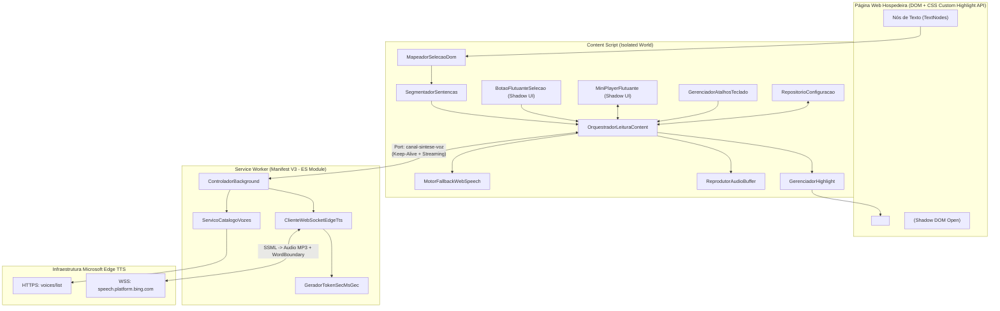
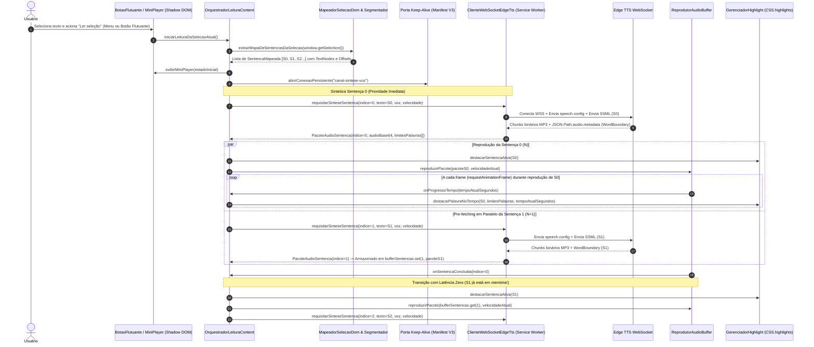

# Plano de Implementação: Extensão Read For Me (Text-to-Speech Manifest V3)

> **Status:** Em Planejamento  
> **Data de Criação:** 2026-10-17  
> **Arquivo Alvo:** `.metadocs/implementation_plan/extensao_tts_completa.md`  
> **Stack & Regras Aplicadas:** JavaScript Moderno (ES2022+) | Chromium Manifest V3 | CSS Custom Highlight API | Shadow DOM | WebSocket Edge TTS | `.agents/rules/language.md` | `.agents/rules/code.md` | `.agents/rules/javascript.md`

---

## 1. Visão Geral e Contexto de Negócio

### 1.1 Objetivo Técnico
Projetar e especificar deterministicamente a arquitetura completa da extensão **Read For Me** para navegadores baseados em Chromium (**Microsoft Edge** e **Brave**) sobre a especificação **Manifest V3**. O sistema realiza leitura de textos selecionados com vozes neurais naturais (`Microsoft Natural Online`) via protocolo WebSocket direto com o endpoint Edge TTS (`speech.platform.bing.com`), fallback transparente para `window.speechSynthesis`, bufferização antecipada de sentenças (*Audio Pre-fetching*) com latência zero entre frases, sincronização visual não-destrutiva de frase e palavra via **CSS Custom Highlight API** (`CSS.highlights`) e interface flutuante arrastável encapsulada em **Shadow DOM**.

### 1.2 O Pilar "Por que?" (Racional Arquitetural e Decisões de Projeto)

- **Problema a Resolver:**
  1. **Assimetria de Vozes entre Edge e Brave:** O navegador Brave não disponibiliza nativamente as vozes neurais online da Microsoft na API `window.speechSynthesis`, limitando o usuário a vozes locais robóticas do sistema operacional.
  2. **Cortes, Timeouts e Latência entre Frases:** Sintetizar blocos inteiros de texto de uma só vez no endpoint neural provoca desconexões por timeout, atraso inicial elevado (*Time-To-First-Audio*) e interrupções abruptas pelo encerramento do Service Worker no Manifest V3.
  3. **Corrupção de DOM em Aplicações Modernas (SPAs):** Extensões tradicionais de leitura injetam tags `<span>` ou `<mark>` ao redor de cada palavra do texto hospedeiro. Isso corrompe a árvore de *Virtual DOM* de aplicações em React, Vue e Angular, dispara *reflows* custosos a cada palavra narrada e degrada a taxa de quadros da página.
  4. **Vazamento de Estilos CSS:** Barras de controle injetadas diretamente no DOM sofrem interferência de folhas de estilo globais da página hospedeira (`* { box-sizing: ... }`, `button { all: unset }`, resets agressivos de Tailwind/Bootstrap).

- **Alternativas Consideradas vs. Escolha Adotada:**
  - *Motor de Síntese de Voz:*
    - **Opção A (Descartada):** Uso exclusivo de `window.speechSynthesis`. Descartada como motor primário porque o Brave não possui as vozes neurais da Microsoft e a precisão do evento `onboundary` varia drasticamente conforme o sistema operacional.
    - **Opção B (Escolhida):** Cliente WebSocket direto para o protocolo `speech.platform.bing.com` ejecutado no Service Worker (isento de restrições CORS da página hospedeira), com fallback automático para `window.speechSynthesis` em caso de ausência de rede ou indisponibilidade do serviço remoto.
  - *Renderização de Destaque Visual (Highlight):*
    - **Opção A (Descartada):** Envolvimento de nós de texto com `<mark class="palavra-ativa">`. Descartada por violar o requisito de zero mutação destrutiva no DOM e provocar quebras de hidratação/reconciliação em SPAs.
    - **Opção B (Descartada):** Sobreposição absoluta via `<canvas>` ou `<div>` calculada com `getClientRects()`. Descartada pelo alto custo computacional de recalcular coordenadas em eventos de *scroll*, redimensionamento e zoom.
    - **Opção C (Escolhida):** **CSS Custom Highlight API** (`CSS.highlights` e objetos `Range`). Opera diretamente no pipeline de pintura do motor Blink sem alterar nenhum nó do DOM, suportando múltiplos `Range`s simultâneos para sentença ativa e palavra ativa.
  - *Reprodução de Áudio e Ciclo de Vida no Manifest V3:*
    - **Opção A (Descartada):** Reproduzir áudio via Web Audio API dentro do Service Worker. Descartada porque Service Workers no Manifest V3 não possuem acesso a `<audio>` ou `AudioContext` e hibernam após 30 segundos.
    - **Opção B (Escolhida):** O Service Worker atua como proxy de streaming WebSocket (gerenciando autenticação `Sec-MS-GEC`, montagem de pacotes SSML e extração de frames binários MP3 + metadados `WordBoundary`), enviando o pacote sintetizado por canal persistente (`chrome.runtime.Port`) ao Content Script da aba ativa, que controla o elemento `HTMLAudioElement` em memória, o relógio de sincronização de `WordBoundary` em `requestAnimationFrame` / `timeupdate` de alta resolução e o *heartbeat* de *keep-alive* do Service Worker.
  - *Empacotamento e Carregamento de Módulos:*
    - **Opção A (Descartada):** Exigir pipeline de *build* com Webpack/Vite para gerar pacotes antes de testar no navegador. Descartada porque dificulta o carregamento imediato via *"Carregar sem compactação"* (*Load unpacked*) direto da raiz do projeto e adiciona dependências desnecessárias.
    - **Opção B (Escolhida):** Arquitetura Vanilla JS modular nativa. O Service Worker utiliza `"type": "module"` nativo do Manifest V3 com ES Modules (`import`/`export`), enquanto os scripts do Content Script registram suas classes em um namespace seguro no *Isolated World* (`globalThis.ReadForMe`) na ordem declarada no `manifest.json`, mantendo exportação condicional (`module.exports` / `export`) para execução direta em testes automatizados.

- **Trade-offs Técnicos:**
  - A geração de áudio em pacotes por sentença e o envio via porta de mensagem serializam o buffer MP3 em Base64 entre Service Worker e Content Script. Como uma sentença média possui entre 15 KB e 60 KB de áudio MP3 (24kHz 48kbps mono), o custo de serialização Base64 é inferior a 1,5ms em memória local IPC, eliminando completamente a complexidade de gerenciar múltiplos *Offscreen Documents* e permitindo controle instantâneo de `playbackRate` (`0.75x` a `2.0x`) com preservação de tom (*pitch preservation* nativo do `HTMLAudioElement`).

- **Alinhamento com Diretrizes de Engenharia:**
  - Todas as classes, funções, variáveis, constantes, mensagens de erro e comentários seguem rigorosamente o contrato de idioma `pt-BR`, com codificação UTF-8 preservada e proibição absoluta de abreviações (`indiceSentencaAtual`, `deslocamentoCaractere`, `comprimentoPalavra`, `configuracaoLeitura`).
  - Cada arquivo respeita o Princípio da Responsabilidade Única (SRP), métodos curtos com *guard clauses* no topo e tratamento explícito de falhas.

---

## 2. Diagramas de Arquitetura e Fluxo de Execução

### 2.1 Diagrama de Componentes da Arquitetura



### 2.2 Diagrama de Sequência: Leitura com Pre-fetching (Buffer N+1) e Sincronização WordBoundary



---

## 3. Mapeamento Estrutural de Arquivos

A estrutura na raiz do repositório permite carregar a extensão diretamente no navegador (`edge://extensions` ou `brave://extensions`) via **Carregar sem compactação** (*Load unpacked*).

| Ação | Caminho do Arquivo | Responsabilidade Única (SRP) |
|---|---|---|
| `Criar` | `manifest.json` | Configuração Manifest V3, permissões (`contextMenus`, `storage`, `activeTab`, `scripting`), atalhos (`commands`), Service Worker e ordem de injeção de Content Scripts. |
| `Criar` | `assets/icons/icon-16.png` | Ícone oficial da extensão em 16x16 pixels para barra de ferramentas e menu de contexto. |
| `Criar` | `assets/icons/icon-48.png` | Ícone oficial da extensão em 48x48 pixels para página de gerenciamento de extensões. |
| `Criar` | `assets/icons/icon-128.png` | Ícone oficial da extensão em 128x128 pixels para instalação e catálogo. |
| `Criar` | `src/shared/constantes_sistema.js` | Constantes imutáveis compartilhadas: tipos de mensagens, chaves de storage, vozes padrão, velocidades permitidas e parâmetros do protocolo Edge TTS. |
| `Criar` | `src/shared/utilitarios_texto.js` | Funções puras de sanitização XML/SSML, geração de UUIDs sem hífens, normalização de espaços e formatação de parâmetros prosódicos. |
| `Criar` | `src/background/gerador_token_sec_ms_gec.js` | Cálculo criptográfico SHA-256 do token `Sec-MS-GEC` exigido pelo handshake WebSocket do Edge TTS baseado em Windows FileTime ticks. |
| `Criar` | `src/background/servico_catalogo_vozes.js` | Busca, filtragem, priorização (`pt-BR` e `en-US` no topo) e cache em `chrome.storage.local` da lista de vozes Microsoft Natural Online. |
| `Criar` | `src/background/cliente_websocket_edge_tts.js` | Cliente WebSocket do protocolo `speech.platform.bing.com`, montagem de cabeçalhos `speech.config` e `ssml`, demultiplexação de frames binários MP3 e frames de metadados `WordBoundary`. |
| `Criar` | `src/background/service_worker.js` | Ponto de entrada do Service Worker: registro do menu de contexto `"Ler seleção"`, gerenciamento de portas de *keep-alive*, roteamento de comandos de atalho e fila de síntese por aba. |
| `Criar` | `src/content/configuracao/repositorio_configuracao.js` | Leitura, gravação e observação reativa de preferências do usuário (`vozSelecionada`, `velocidadeReproducao`, `idiomaFiltro`, `posicaoMiniPlayer`) no `chrome.storage.local`. |
| `Criar` | `src/content/dom/segmentador_sentencas.js` | Divisão inteligente de texto selecionado em sentenças lógicas (`Sentence Chunking`) via `Intl.Segmenter` e heurística anti-abreviação, preservando índices globais de caracteres. |
| `Criar` | `src/content/dom/mapeador_selecao_dom.js` | Varredura de `Selection` via `TreeWalker` para mapear deslocamentos globais de caracteres em referências exatas de `TextNode` e fabricar objetos `Range` sem mutar o DOM. |
| `Criar` | `src/content/destaque/estilos_highlight.css` | Folha de estilos injetada no documento raiz exclusivamente para os pseudo-elementos `::highlight(leitura-frase-ativa)` e `::highlight(leitura-palavra-ativa)`. |
| `Criar` | `src/content/destaque/gerenciador_highlight.js` | Controlador da **CSS Custom Highlight API** (`CSS.highlights`), gerenciando o destaque simultâneo da sentença ativa e da palavra corrente com limpeza instantânea. |
| `Criar` | `src/content/audio/reprodutor_audio_buffer.js` | Reprodutor baseado em `HTMLAudioElement` operando sobre `Blob` URLs em memória, loop de sincronização temporal em `requestAnimationFrame` para disparo preciso de `WordBoundary` e ajuste em tempo real de `playbackRate`. |
| `Criar` | `src/content/audio/motor_fallback_web_speech.js` | Motor de contingência utilizando `window.speechSynthesis` com interface idêntica ao reprodutor principal e mapeamento de eventos `onboundary` para os mesmos callbacks de destaque. |
| `Criar` | `src/content/ui/estilos_shadow_ui.js` | Definição encapsulada de CSS para o Shadow DOM: estética Glassmorphism / Dark Mode elegante, animações suaves, seletores customizados e responsividade do Mini-Player e do botão flutuante. |
| `Criar` | `src/content/ui/botao_flutuante_selecao.js` | Componente visual discreto dentro do Shadow DOM que aparece próximo às coordenadas da seleção de texto para iniciar a leitura com um clique. |
| `Criar` | `src/content/ui/mini_player_flutuante.js` | Barra flutuante arrastável (*Draggable* via Pointer Events) no Shadow DOM contendo Play/Pause, Stop, Anterior/Próxima sentença, seletor de velocidade (`0.75x` a `2.0x`) e seletor de vozes com filtro de idioma. |
| `Criar` | `src/content/atalhos/gerenciador_atalhos_teclado.js` | Interceptador de eventos de teclado para `Espaço` (quando o Mini-Player possui foco no Shadow DOM), `Alt+Shift+S` (pausar/retomar) e `Esc` (parar leitura e limpar highlights). |
| `Criar` | `src/content/orquestrador_leitura_content.js` | Máquina de estados central do Content Script: coordena o *Sentence Chunking*, o *Pre-fetching* da sentença `N+1` enquanto `N` reproduz, o canal de *keep-alive* com o Service Worker, a UI e o motor de highlight. |

---

## 4. Especificação Técnica Detalhada por Módulo (O "Como?" e o "Por que?")

---

### 4.1 Módulo: `manifest.json`

#### 4.1.1 O "Por que?" Deste Módulo
- **Motivação:** Definir o contrato declarativo da extensão perante o motor Chromium (Microsoft Edge e Brave) seguindo estritamente o Manifest V3.
- **Decisão Técnica Específica:**
  - Uso de `"permissions": ["contextMenus", "storage", "activeTab"]` e `"host_permissions": ["wss://*.bing.com/*", "https://*.bing.com/*"]` para permitir que o Service Worker conecte ao endpoint do Edge TTS e consulte o catálogo de vozes sem bloqueio de CORS.
  - Registro do comando `"alternar-pausa-leitura"` mapeado para `Alt+Shift+S` na seção `"commands"`, garantindo funcionamento mesmo quando o foco estiver fora da página, complementado pelo listener local de teclado no Content Script.
  - Injeção ordenada dos arquivos do Content Script em `"all_frames": false` e `"run_at": "document_idle"` para zero impacto no tempo de carregamento inicial (*First Contentful Paint*) dos sites visitados.

#### 4.1.2 O "Como?" Técnico (Estrutura Completa do Arquivo)
```json
{
  "manifest_version": 3,
  "name": "Read For Me — Leitor Neural de Alta Performance",
  "short_name": "Read For Me",
  "version": "1.0.0",
  "description": "Leitura fluida de textos selecionados com vozes Microsoft Natural Online, highlight não-destrutivo e mini-player em Shadow DOM para Edge e Brave.",
  "minimum_chrome_version": "105",
  "icons": {
    "16": "assets/icons/icon-16.png",
    "48": "assets/icons/icon-48.png",
    "128": "assets/icons/icon-128.png"
  },
  "permissions": [
    "contextMenus",
    "storage",
    "activeTab"
  ],
  "host_permissions": [
    "https://speech.platform.bing.com/*",
    "wss://speech.platform.bing.com/*"
  ],
  "background": {
    "service_worker": "src/background/service_worker.js",
    "type": "module"
  },
  "commands": {
    "alternar-pausa-leitura": {
      "suggested_key": {
        "default": "Alt+Shift+S"
      },
      "description": "Pausar ou retomar a leitura atual"
    }
  },
  "content_scripts": [
    {
      "matches": ["<all_urls>"],
      "css": [
        "src/content/destaque/estilos_highlight.css"
      ],
      "js": [
        "src/shared/constantes_sistema.js",
        "src/shared/utilitarios_texto.js",
        "src/content/configuracao/repositorio_configuracao.js",
        "src/content/dom/segmentador_sentencas.js",
        "src/content/dom/mapeador_selecao_dom.js",
        "src/content/destaque/gerenciador_highlight.js",
        "src/content/audio/reprodutor_audio_buffer.js",
        "src/content/audio/motor_fallback_web_speech.js",
        "src/content/ui/estilos_shadow_ui.js",
        "src/content/ui/botao_flutuante_selecao.js",
        "src/content/ui/mini_player_flutuante.js",
        "src/content/atalhos/gerenciador_atalhos_teclado.js",
        "src/content/orquestrador_leitura_content.js"
      ],
      "run_at": "document_idle"
    }
  ]
}
```

---

### 4.2 Módulo: `src/shared/constantes_sistema.js` e `src/shared/utilitarios_texto.js`

#### 4.2.1 O "Por que?" Destes Módulos
- **Motivação:** Centralizar todas as constantes de protocolo, chaves de armazenamento, catálogo estático de contingência e funções utilitárias de texto, eliminando *magic strings* e duplicação entre Service Worker e Content Script.
- **Decisão Técnica Específica:** Como os arquivos em `src/shared/` são importados pelo Service Worker (ES Modules) e também carregados pelo Content Script (Isolated World), cada arquivo registra suas exportações em `globalThis.ReadForMe` e simultaneamente suporta uso via módulo.

#### 4.2.2 O "Como?" Técnico (Contratos, Assinaturas e Estruturas)
```javascript
/**
 * Declaração das constantes globais do sistema Read For Me.
 */
const CONSTANTES_SISTEMA = Object.freeze({
  ID_MENU_CONTEXTO: 'read-for-me-ler-selecao',
  NOME_PORTA_KEEP_ALIVE: 'read-for-me-canal-sintese-voz',
  INTERVALO_HEARTBEAT_MS: 20000,
  TIMEOUT_CONEXAO_WS_MS: 10000,
  MAXIMO_TENTATIVAS_WS: 2,
  TOKEN_CLIENTE_CONFIAVEL_EDGE: '6A5AA1D4EAFF4E9FB37E23D68491D6F4',
  VERSAO_CHROMIUM_SIMULADA: '130.0.2849.68',
  VERSAO_FULL_SEC_MS_GEC: '130.0.2849.68',
  URL_LISTA_VOZES_EDGE:
    'https://speech.platform.bing.com/consumer/speech/synthesize/readaloud/voices/list?trustedclienttoken=6A5AA1D4EAFF4E9FB37E23D68491D6F4',
  URL_BASE_WEBSOCKET_EDGE:
    'wss://speech.platform.bing.com/consumer/speech/synthesize/readaloud/edge/v1',
  FORMATO_SAIDA_AUDIO: 'audio-24khz-48kbitrate-mono-mp3',
  NOMES_HIGHLIGHT: Object.freeze({
    FRASE_ATIVA: 'leitura-frase-ativa',
    PALAVRA_ATIVA: 'leitura-palavra-ativa'
  }),
  CHAVES_STORAGE: Object.freeze({
    VOZ_SELECIONADA: 'readForMe_vozSelecionada',
    VELOCIDADE_REPRODUCAO: 'readForMe_velocidadeReproducao',
    IDIOMA_FILTRO: 'readForMe_idiomaFiltro',
    POSICAO_MINI_PLAYER: 'readForMe_posicaoMiniPlayer',
    CACHE_CATALOGO_VOZES: 'readForMe_cacheCatalogoVozes'
  }),
  VALORES_PADRAO: Object.freeze({
    VOZ_SELECIONADA: 'pt-BR-FranciscaNeural',
    VELOCIDADE_REPRODUCAO: 1.0,
    IDIOMA_FILTRO: 'TODOS'
  }),
  VELOCIDADES_DISPONIVEIS: Object.freeze([0.75, 1.0, 1.25, 1.5, 2.0]),
  IDIOMAS_PRIORITARIOS: Object.freeze(['pt-BR', 'en-US']),
  TIPOS_MENSAGEM: Object.freeze({
    INICIAR_LEITURA_MENU: 'INICIAR_LEITURA_MENU',
    ALTERNAR_PAUSA_ATALHO: 'ALTERNAR_PAUSA_ATALHO',
    SINTETIZAR_SENTENCA: 'SINTETIZAR_SENTENCA',
    CANCELAR_SINTESE_ABA: 'CANCELAR_SINTESE_ABA',
    OBTER_CATALOGO_VOZES: 'OBTER_CATALOGO_VOZES',
    HEARTBEAT_KEEP_ALIVE: 'HEARTBEAT_KEEP_ALIVE',
    PACOTE_AUDIO_PRONTO: 'PACOTE_AUDIO_PRONTO',
    FALHA_SINTESE_USAR_FALLBACK: 'FALHA_SINTESE_USAR_FALLBACK'
  }),
  VOZES_NATURAIS_INTEGRADA_PADRAO: Object.freeze([
    {
      nomeCurto: 'pt-BR-FranciscaNeural',
      nomeExibicao: 'Francisca (Português Brasil - Natural)',
      idioma: 'pt-BR',
      genero: 'Female'
    },
    {
      nomeCurto: 'pt-BR-AntonioNeural',
      nomeExibicao: 'Antonio (Português Brasil - Natural)',
      idioma: 'pt-BR',
      genero: 'Male'
    },
    {
      nomeCurto: 'pt-BR-ThalitaMultilingualNeural',
      nomeExibicao: 'Thalita Multilíngue (Português Brasil - Natural)',
      idioma: 'pt-BR',
      genero: 'Female'
    },
    {
      nomeCurto: 'en-US-AriaNeural',
      nomeExibicao: 'Aria (English US - Natural)',
      idioma: 'en-US',
      genero: 'Female'
    },
    {
      nomeCurto: 'en-US-GuyNeural',
      nomeExibicao: 'Guy (English US - Natural)',
      idioma: 'en-US',
      genero: 'Male'
    },
    {
      nomeCurto: 'en-US-JennyNeural',
      nomeExibicao: 'Jenny (English US - Natural)',
      idioma: 'en-US',
      genero: 'Female'
    },
    {
      nomeCurto: 'en-US-AndrewMultilingualNeural',
      nomeExibicao: 'Andrew Multilingual (English US - Natural)',
      idioma: 'en-US',
      genero: 'Male'
    }
  ])
});
```

- **Funções de `src/shared/utilitarios_texto.js`:**
```javascript
/**
 * Gera um identificador hexadecimal de 32 caracteres sem hífens para X-ConnectionId e X-RequestId.
 * @returns {string} Identificador hexadecimal em letras minúsculas.
 */
function gerarIdentificadorConexaoHex() {
  const bytesAleatorios = new Uint8Array(16);
  crypto.getRandomValues(bytesAleatorios);
  return Array.from(bytesAleatorios, (byteAtual) =>
    byteAtual.toString(16).padStart(2, '0')
  ).join('');
}

/**
 * Escapa caracteres especiais XML (&, <, >, ", ') para inserção segura em envelope SSML.
 * Mantém um mapa de deslocamento para reconstruir o offset original no texto não escapado.
 * @param {string} textoOriginal - Texto puro da sentença.
 * @returns {{ textoEscapado: string, mapaOffsetSsmlParaOriginal: number[] }}
 */
function escaparTextoParaSsmlComMapa(textoOriginal) {
  // Algoritmo detalhado abaixo
}

/**
 * Monta o envelope SSML completo para o protocolo Edge TTS.
 * Observação Arquitetural: A velocidade no SSML é mantida em '+0%' quando o HTMLAudioElement
 * aplica playbackRate dinâmico, garantindo que a alteração de velocidade em tempo real (0.75x a 2.0x)
 * funcione instantaneamente mesmo para sentenças que já estão no buffer de Pre-fetching!
 * @param {string} textoEscapado - Texto já sanitizado para XML.
 * @param {string} nomeVoz - Nome curto da voz (ex.: 'pt-BR-FranciscaNeural').
 * @param {string} idiomaVoz - Código de idioma (ex.: 'pt-BR').
 * @returns {string} Envelope SSML formatado.
 */
function construirEnvelopeSsml(textoEscapado, nomeVoz, idiomaVoz) {
  return (
    `<speak version='1.0' xmlns='http://www.w3.org/2001/10/synthesis' xml:lang='${idiomaVoz}'>` +
    `<voice name='${nomeVoz}'>` +
    `<prosody pitch='+0Hz' rate='+0%' volume='+0%'>${textoEscapado}</prosody>` +
    `</voice></speak>`
  );
}
```
- **Por que manter `rate='+0%'` no SSML e controlar a velocidade via `HTMLAudioElement.playbackRate`?**
  - **Racional Crítico:** O PRD exige dois comportamentos simultâneos:
    1. *Audio Pre-fetching (Buffer)*: a sentença `N+1` já está sintetizada em memória enquanto `N` toca;
    2. *Seletor rápido de velocidade (`0.75x`, `1.0x`, `1.25x`, `1.5x`, `2.0x`) que altera o ritmo em tempo real*.
  - Se a velocidade fosse embutida estaticamente no áudio MP3 via SSML, alterar o seletor de velocidade durante a leitura não alteraria a frase atual em tempo real e invalidaria o buffer da sentença `N+1` (exigindo nova requisição WebSocket e causando latência). Ao sintetizar em `1.0x` (`rate='+0%'`) e aplicar `elementoAudio.playbackRate = velocidadeEscolhida` com `elementoAudio.preservesPitch = true`, a mudança de velocidade tem **efeito instantâneo em 0ms** no meio da palavra falada, preserva o buffer `N+1` intacto e mantém 100% de precisão nos metadados `WordBoundary` (pois `elementoAudio.currentTime` avança proporcionalmente ao `playbackRate`). No motor de fallback (`window.speechSynthesis`), a taxa `Utterance.rate = velocidadeEscolhida` é aplicada diretamente.

---

### 4.3 Módulo: `src/background/gerador_token_sec_ms_gec.js`

#### 4.3.1 O "Por que?" Deste Módulo
- **Motivação:** O endpoint WebSocket `wss://speech.platform.bing.com/consumer/speech/synthesize/readaloud/edge/v1` exige os parâmetros de query `TrustedClientToken` e `Sec-MS-GEC` (além de `Sec-MS-GEC-Version`) para autorizar conexões originadas fora do binário interno do navegador Edge (como no Brave). Sem esse token criptográfico atualizado a cada janela de 5 minutos, o servidor retorna HTTP 403 no handshake do WebSocket.

#### 4.3.2 O "Como?" Técnico (Contratos e Algoritmo Passo a Passo)
```javascript
/**
 * Responsável por gerar o token de segurança DRM Sec-MS-GEC exigido pelo endpoint Edge TTS.
 */
export class GeradorTokenSecMsGec {
  /**
   * Calcula o hash SHA-256 em caixa alta baseado no timestamp Windows FileTime arredondado para 5 minutos.
   * @param {string} tokenClienteConfiavel - Token público do cliente ReadAloud.
   * @returns {Promise<string>} Hash SHA-256 hexadecimal em letras maiúsculas (64 caracteres).
   */
  static async gerarTokenSeguranca(tokenClienteConfiavel) {
    const SEGUNDOS_ENTRE_1601_E_1970 = 11644473600;
    const INTERVALO_ARREDONDAMENTO_SEGUNDOS = 300;
    const TICKS_POR_SEGUNDO = 10000000;

    const segundosUnixAtual = Math.floor(Date.now() / 1000);
    const segundosWindowsEpoch = segundosUnixAtual + SEGUNDOS_ENTRE_1601_E_1970;
    const segundosArredondados =
      segundosWindowsEpoch - (segundosWindowsEpoch % INTERVALO_ARREDONDAMENTO_SEGUNDOS);
    const ticksWindowsFileTime = BigInt(segundosArredondados) * BigInt(TICKS_POR_SEGUNDO);

    const cadeiaParaAssinar = `${ticksWindowsFileTime.toString()}${tokenClienteConfiavel}`;
    const bytesEntrada = new TextEncoder().encode(cadeiaParaAssinar);
    const bufferDigest = await crypto.subtle.digest('SHA-256', bytesEntrada);

    return Array.from(new Uint8Array(bufferDigest), (byteAtual) =>
      byteAtual.toString(16).padStart(2, '0').toUpperCase()
    ).join('');
  }
}
```
- **Algoritmo Passo a Passo:**
  1. **Passo 1:** Obter o timestamp Unix atual em segundos (`Math.floor(Date.now() / 1000)`).
  2. **Passo 2:** Somar `11644473600` (diferença em segundos entre `1601-01-01T00:00:00Z` e `1970-01-01T00:00:00Z`).
  3. **Passo 3:** Arredondar para baixo no múltiplo de `300` segundos (5 minutos) mais próximo.
  4. **Passo 4:** Multiplicar por `10_000_000` usando `BigInt` para converter segundos em intervalos de 100 nanossegundos (Windows FileTime ticks).
  5. **Passo 5:** Concatenar a representação decimal dos ticks com `6A5AA1D4EAFF4E9FB37E23D68491D6F4` e calcular o `SHA-256` via `crypto.subtle.digest`, convertendo para hexadecimal maiúsculo.

---

### 4.4 Módulo: `src/background/servico_catalogo_vozes.js`

#### 4.4.1 O "Por que?" Deste Módulo
- **Motivação:** Cumprir o requisito 4 do PRD: *"Seletor de Vozes Naturais com filtro por idioma (priorizando `pt-BR` e `en-US` no topo)"*.
- **Decisão Técnica Específica:** Buscar a lista oficial de vozes da Microsoft via HTTPS, filtrar vozes neurais naturais (`ShortName` contendo `Neural`), ordenar colocando `pt-BR` em primeiro lugar, `en-US` em segundo lugar e os demais idiomas em ordem alfabética, armazenando o resultado em cache no `chrome.storage.local` por 24 horas com fallback imediato para `VOZES_NATURAIS_INTEGRADA_PADRAO` caso a requisição falhe.

#### 4.4.2 O "Como?" Técnico (Contratos e Assinaturas)
```javascript
/**
 * Gerencia a obtenção, normalização, ordenação prioritária e cache do catálogo de vozes Microsoft Natural.
 */
export class ServicoCatalogoVozes {
  /**
   * Retorna a lista de vozes naturais ordenada com pt-BR e en-US no topo.
   * @returns {Promise<Array<{nomeCurto: string, nomeExibicao: string, idioma: string, genero: string}>>}
   */
  static async obterCatalogoVozesOrdenado() {
    // 1. Verifica cache válido (< 24h) em chrome.storage.local
    // 2. Se expirado ou ausente, executa fetch(CONSTANTES_SISTEMA.URL_LISTA_VOZES_EDGE)
    // 3. Mapeia cada item { ShortName, FriendlyName, Locale, Gender } para o contrato interno
    // 4. Ordena com comparador de prioridade: pt-BR (peso 0), en-US (peso 1), outros (peso 2 + localeCompare)
    // 5. Em caso de erro de rede, retorna CONSTANTES_SISTEMA.VOZES_NATURAIS_INTEGRADA_PADRAO
  }
}
```

---

### 4.5 Módulo: `src/background/cliente_websocket_edge_tts.js`

#### 4.5.1 O "Por que?" Deste Módulo
- **Motivação:** Isolar toda a complexidade de rede, protocolo de quadros texto/binário do Edge TTS e extração de metadados `WordBoundary` em uma classe dedicada no Service Worker.
- **Decisão Técnica Específica:**
  - O protocolo WebSocket do Edge TTS envia dois tipos de quadros na mesma conexão:
    1. **Quadros de Texto (`typeof evento.data === 'string'`):** Contêm cabeçalhos HTTP-like separados do corpo por `\r\n\r\n`.
       - Quando o cabeçalho contém `Path:audio.metadata`, o corpo JSON possui `{ "Metadata": [{ "Type": "WordBoundary", "Data": { "Offset": 1250000, "Duration": 3125000, "text": { "Text": "exemplo", "Length": 7, "BoundaryType": "WordBoundary" } } }] }`.
       - Quando o cabeçalho contém `Path:turn.end`, indica que a síntese daquela requisição SSML terminou com sucesso.
    2. **Quadros Binários (`evento.data instanceof ArrayBuffer` ou `Blob`):**
       - Os primeiros `2 bytes` (Big-Endian `Uint16`) indicam o tamanho em bytes do cabeçalho ASCII daquele frame.
       - O cabeçalho ASCII situa-se entre o byte `2` e `2 + tamanhoCabecalho`. Se esse cabeçalho contiver `Path:audio`, todos os bytes a partir do índice `2 + tamanhoCabecalho` até o fim do `ArrayBuffer` são bytes puros do stream de áudio MP3!

#### 4.5.2 O "Como?" Técnico (Contratos, Assinaturas e Algoritmo Passo a Passo)
```javascript
/**
 * Cliente de comunicação WebSocket com o endpoint speech.platform.bing.com.
 */
export class ClienteWebSocketEdgeTts {
  /**
   * Sintetiza uma única sentença e retorna o buffer MP3 codificado em Base64 junto com os limites de palavras.
   * @param {Object} parametrosSintese - Parâmetros da requisição de síntese.
   * @param {string} parametrosSintese.textoSentenca - Texto original da sentença.
   * @param {string} parametrosSintese.nomeVoz - Nome curto da voz (ex.: 'pt-BR-FranciscaNeural').
   * @param {AbortSignal} [parametrosSintese.sinalAborto] - Sinal para cancelamento imediato da conexão.
   * @returns {Promise<{audioBase64: string, limitesPalavras: Array<{tempoInicioSegundos: number, duracaoSegundos: number, textoPalavra: string, indiceInicialCaractere: number, comprimentoPalavra: number}>}>}
   */
  async sintetizarSentenca({ textoSentenca, nomeVoz, sinalAborto }) {
    // Implementação determinística conforme passos abaixo
  }
}
```

- **Protocolo Exato dos Quadros Enviados ao Servidor WebSocket:**
  1. **Quadro 1 (`speech.config`):**
     ```text
     X-Timestamp:Thu Oct 17 2026 23:15:00 GMT-0300 (Horário Padrão de Brasília)\r\nContent-Type:application/json; charset=utf-8\r\nPath:speech.config\r\n\r\n{"context":{"synthesis":{"audio":{"metadataoptions":{"sentenceBoundaryEnabled":"false","wordBoundaryEnabled":"true"},"outputFormat":"audio-24khz-48kbitrate-mono-mp3"}}}}
     ```
  2. **Quadro 2 (`ssml`):**
     ```text
     X-RequestId:<uuid32hex>\r\nContent-Type:application/ssml+xml\r\nX-Timestamp:Thu Oct 17 2026 23:15:00 GMT-0300\r\nPath:ssml\r\n\r\n<speak version='1.0' xmlns='http://www.w3.org/2001/10/synthesis' xml:lang='pt-BR'><voice name='pt-BR-FranciscaNeural'><prosody pitch='+0Hz' rate='+0%' volume='+0%'>Texto da sentença escapado.</prosody></voice></speak>
     ```

- **Algoritmo Passo a Passo de Demultiplexação e Alinhamento de `WordBoundary`:**
  1. **Passo 1 (Guard Clauses):** Validar se `textoSentenca` não é vazio após `trim()`. Se for vazio, rejeitar com erro descritivo em `pt-BR`.
  2. **Passo 2 (Construção da URL Autenticada):** Gerar `idConexao = gerarIdentificadorConexaoHex()` e `tokenGec = await GeradorTokenSecMsGec.gerarTokenSeguranca(...)`. Montar a URL:
     `wss://speech.platform.bing.com/consumer/speech/synthesize/readaloud/edge/v1?TrustedClientToken=6A5AA1D4EAFF4E9FB37E23D68491D6F4&Sec-MS-GEC=${tokenGec}&Sec-MS-GEC-Version=1-130.0.2849.68&ConnectionId=${idConexao}`.
  3. **Passo 3 (Abertura do WebSocket):** Instanciar `ws = new WebSocket(urlCompleta)` e configurar `ws.binaryType = 'arraybuffer'`. Iniciar timer de segurança de `10000ms` para timeout de conexão.
  4. **Passo 4 (Handshake no `onopen`):** Enviar imediatamente o quadro `speech.config` (com `wordBoundaryEnabled: "true"`) seguido do quadro `ssml`.
  5. **Passo 5 (Processamento de Mensagens no `onmessage`):**
     - **Se `typeof evento.data === 'string'`:**
       - Se contiver `Path:audio.metadata`: extrair a substring após `\r\n\r\n`, fazer `JSON.parse(corpoJson)` e iterar sobre `objeto.Metadata`.
       - Para cada item com `Type === 'WordBoundary'`:
         - Converter ticks de 100ns para segundos: `tempoInicioSegundos = item.Data.Offset / 10_000_000` e `duracaoSegundos = item.Data.Duration / 10_000_000`.
         - Localizar a posição exata de `item.Data.text.Text` na string `textoSentenca` original a partir de um ponteiro progressivo `cursorBuscaTextoSentenca` (utilizando busca exata case-insensitive a partir de `cursorBuscaTextoSentenca`).
         - **Por que usar um cursor progressivo sobre `textoSentenca` em vez do `textOffset` bruto do SSML?** Porque o `textOffset` retornado pelo servidor Edge TTS inclui o comprimento do cabeçalho XML `<speak><voice><prosody>...` e varia conforme entidades XML escapadas (`&amp;`, `&quot;`). O cursor progressivo localiza a palavra diretamente na string original da sentença (`textoSentenca.indexOf(textoPalavra, cursorBuscaTextoSentenca)`), garantindo **100% de precisão de índice de caractere** sem jamais errar por deslocamento de tags SSML!
     - **Se `evento.data instanceof ArrayBuffer`:**
       - Ler `tamanhoCabecalho = new DataView(evento.data).getUint16(0, false)` (Big-Endian).
       - Decodificar o cabeçalho ASCII `new TextDecoder().decode(evento.data.slice(2, 2 + tamanhoCabecalho))`.
       - Se o cabeçalho contiver `Path:audio`, extrair `fatiaMp3 = new Uint8Array(evento.data, 2 + tamanhoCabecalho)` e anexar à lista `partesAudioMp3`.
     - **Se contiver `Path:turn.end`:**
       - Concatenar todos os `Uint8Array` de `partesAudioMp3` em um único `Uint8Array`, converter para `audioBase64`, fechar o WebSocket com código `1000` e resolver a `Promise`.
  6. **Passo 6 (Retry e Resiliência):** Se o WebSocket fechar prematuramente sem `Path:turn.end` ou atingir timeout, repetir até `MAXIMO_TENTATIVAS_WS` (2 vezes). Se persistir a falha, lançar exceção estruturada para que o `OrquestradorLeituraContent` acione imediatamente o fallback `MotorFallbackWebSpeech`.

---

### 4.6 Módulo: `src/background/service_worker.js`

#### 4.6.1 O "Por que?" Deste Módulo
- **Motivação:** Gerenciar o ciclo de vida em segundo plano da extensão: criar o item `"Ler seleção"` no menu de contexto, escutar o atalho global `Alt+Shift+S`, manter o Service Worker acordado durante toda a sessão de leitura e processar pedidos de síntese de áudio e catálogo de vozes.
- **Decisão Técnica Específica (Prevenção de Hibernação no Manifest V3):**
  - No Chromium Manifest V3, um Service Worker hiberna após 30 segundos sem eventos. Quando o Content Script inicia uma leitura, ele abre uma porta de longa duração (`chrome.runtime.connect({ name: 'read-for-me-canal-sintese-voz' })`) e envia mensagens de *heartbeat* (`HEARTBEAT_KEEP_ALIVE`) a cada 20 segundos enquanto a leitura estiver em estado `REPRODUZINDO` ou `PAUSADO`. O Service Worker responde a cada *heartbeat*, zerando o cronômetro de inatividade do Chromium e mantendo o processo vivo sem interrupções em textos longos.

#### 4.6.2 O "Como?" Técnico (Contratos e Fluxo Passo a Passo)
```javascript
/**
 * Controlador principal do Service Worker (Manifest V3).
 */
export class ControladorBackground {
  constructor() {
    this.clienteEdgeTts = new ClienteWebSocketEdgeTts();
    this.controladoresAbortoPorAba = new Map();
  }

  /**
   * Inicializa os listeners de instalação, menu de contexto, atalhos e portas de conexão.
   * @returns {void}
   */
  inicializar() {
    // 1. chrome.runtime.onInstalled -> cria contextMenus.create({ id: 'read-for-me-ler-selecao', title: 'Ler seleção', contexts: ['selection'] })
    // 2. chrome.contextMenus.onClicked -> envia mensagem INICIAR_LEITURA_MENU para a aba ativa
    // 3. chrome.commands.onCommand -> envia mensagem ALTERNAR_PAUSA_ATALHO para a aba ativa
    // 4. chrome.runtime.onConnect -> gerencia a porta 'read-for-me-canal-sintese-voz'
    // 5. chrome.runtime.onMessage -> responde OBTER_CATALOGO_VOZES
  }
}
```

- **Esquema de Mensagens na Porta `read-for-me-canal-sintese-voz`:**
  - **Requisição (Content Script -> Service Worker):**
    ```json
    {
      "tipoMensagem": "SINTETIZAR_SENTENCA",
      "payload": {
        "idSessaoLeitura": "sessao-1729217520000",
        "indiceSentenca": 0,
        "textoSentenca": "Esta é a primeira frase selecionada pelo usuário.",
        "nomeVoz": "pt-BR-FranciscaNeural"
      }
    }
    ```
  - **Resposta de Sucesso (Service Worker -> Content Script):**
    ```json
    {
      "tipoMensagem": "PACOTE_AUDIO_PRONTO",
      "payload": {
        "idSessaoLeitura": "sessao-1729217520000",
        "indiceSentenca": 0,
        "audioBase64": "//NExAAAAANIAAAAAExBTUUzLjEwMKqq...",
        "limitesPalavras": [
          {
            "tempoInicioSegundos": 0.05,
            "duracaoSegundos": 0.22,
            "textoPalavra": "Esta",
            "indiceInicialCaractere": 0,
            "comprimentoPalavra": 4
          }
        ]
      }
    }
    ```
  - **Resposta de Contingência (Service Worker -> Content Script):**
    ```json
    {
      "tipoMensagem": "FALHA_SINTESE_USAR_FALLBACK",
      "payload": {
        "idSessaoLeitura": "sessao-1729217520000",
        "indiceSentenca": 0,
        "motivoErro": "Falha ao conectar ao endpoint Edge TTS após 2 tentativas."
      }
    }
    ```

---

### 4.7 Módulo: `src/content/dom/segmentador_sentencas.js` e `src/content/dom/mapeador_selecao_dom.js`

#### 4.7.1 O "Por que?" Destes Módulos
- **Motivação:** Cumprir os requisitos de **Sentence Chunking** (divisão lógica em sentenças sem cortes abruptos) e **Zero Mutação Destrutiva no DOM** (mapeamento exato de qualquer intervalo de caracteres da seleção para objetos `Range` nativos sobre os `TextNode`s originais da página).
- **Decisão Técnica Específica:**
  - Uma seleção do usuário na página web frequentemente atravessa dezenas de elementos HTML (`<p>`, `<strong>`, `<a>`, `<li>`, `<code>`).
  - Se simplesmente lêssemos `selection.toString()`, perderíamos a referência de qual `TextNode` contém cada palavra para iluminar com a `CSS Custom Highlight API`.
  - Por isso, `MapeadorSelecaoDom` percorre os nós de texto intersectados pelo `Range` da seleção usando `document.createTreeWalker(ancestralComum, NodeFilter.SHOW_TEXT)`, construindo um vetor contíguo de segmentos de nós de texto com seus offsets acumulados (`inicioGlobal`, `fimGlobal`, `noTexto`, `offsetInicialNoNo`, `offsetFinalNoNo`).
  - Sobre essa string concatenada, `SegmentadorSentencas` aplica `Intl.Segmenter('pt-BR', { granularity: 'sentence' })` (com pós-processamento para unir abreviações como `Sr.`, `Dr.`, `Prof.`, `etc.`, `nº.`, `fig.`) e também divide blocos sem pontuação que ultrapassem `280` caracteres no delimitador de vírgula ou espaço mais próximo, evitando qualquer timeout de síntese.

#### 4.7.2 O "Como?" Técnico (Contratos, Assinaturas e Algoritmos)
```javascript
/**
 * Divide um texto linear em sentenças lógicas preservando os índices de início e fim no texto original.
 */
class SegmentadorSentencas {
  /**
   * @param {string} textoCompleto - Texto linear extraído da seleção.
   * @returns {Array<{indiceSentenca: number, textoSentenca: string, indiceInicialGlobal: number, indiceFinalGlobal: number}>}
   */
  static segmentarTextoEmSentencas(textoCompleto) {
    // Algoritmo passo a passo abaixo
  }
}

/**
 * Mapeia uma seleção do DOM em nós de texto concretos e fabrica objetos Range para qualquer intervalo global.
 */
class MapeadorSelecaoDom {
  /**
   * Captura a seleção atual do usuário e constrói o mapa de nós e sentenças sem modificar o DOM.
   * @param {Selection} selecaoNavegador - Objeto retornado por window.getSelection().
   * @returns {{textoCompleto: string, sentencasMapeadas: Array<{indiceSentenca: number, textoSentenca: string, indiceInicialGlobal: number, indiceFinalGlobal: number}>, retanguloAncoraInicial: DOMRect, criarRangesParaIntervaloGlobal: function(number, number): Range[]} | null}
   */
  static mapearSelecaoAtual(selecaoNavegador) {
    // Algoritmo passo a passo abaixo
  }
}
```

- **Algoritmo Passo a Passo de `MapeadorSelecaoDom.mapearSelecaoAtual`:**
  1. **Passo 1 (Guard Clause):** Verificar se `selecaoNavegador` existe, `selecaoNavegador.rangeCount > 0` e `!selecaoNavegador.isCollapsed`. Caso contrário, retornar `null`.
  2. **Passo 2 (Clonagem do Range Original):** Obter `rangeSelecao = selecaoNavegador.getRangeAt(0).cloneRange()` e `retanguloAncoraInicial = rangeSelecao.getBoundingClientRect()`.
  3. **Passo 3 (Coleta de TextNodes):**
     - Se `rangeSelecao.commonAncestorContainer.nodeType === Node.TEXT_NODE`, registrar esse único `TextNode` com `[rangeSelecao.startOffset, rangeSelecao.endOffset]`.
     - Caso contrário, instanciar `TreeWalker` sobre `rangeSelecao.commonAncestorContainer` filtrando `NodeFilter.SHOW_TEXT`. Ignorar nós dentro de `<script>`, `<style>`, `<noscript>` ou do próprio `#read-for-me-host-raiz`.
     - Para cada `noTexto` que intersecta `rangeSelecao` (`rangeSelecao.intersectsNode(noTexto)`):
       - Determinar `offsetInicialNoNo = (noTexto === rangeSelecao.startContainer) ? rangeSelecao.startOffset : 0`.
       - Determinar `offsetFinalNoNo = (noTexto === rangeSelecao.endContainer) ? rangeSelecao.endOffset : noTexto.nodeValue.length`.
       - Se `offsetFinalNoNo > offsetInicialNoNo`, adicionar uma entrada em `segmentosNosTexto` com `{ noTexto, offsetInicialNoNo, offsetFinalNoNo, inicioGlobal, fimGlobal }`.
       - Se o próximo `noTexto` pertencer a um bloco HTML diferente (`<p>`, `<div>`, `<li>`, `<h1>`-`<h6>`, `<blockquote>`, `<tr>`), inserir um separador virtual `\n` na string acumulada para que o `SegmentadorSentencas` jamais funda o fim de um parágrafo sem ponto final com o início do próximo parágrafo!
  4. **Passo 4 (Fábrica de Ranges Não-Destrutiva `criarRangesParaIntervaloGlobal(inicioGlobalAlvo, fimGlobalAlvo)`):**
     - Filtrar todos os itens de `segmentosNosTexto` cujo intervalo `[inicioGlobal, fimGlobal]` possui interseção com `[inicioGlobalAlvo, fimGlobalAlvo]` e cujo `noTexto.isConnected` seja `true`.
     - Para cada segmento intersectado:
       - Criar `novoRange = document.createRange()`.
       - Calcular `deslocamentoInicioLocal = segment.offsetInicialNoNo + Math.max(0, inicioGlobalAlvo - segment.inicioGlobal)`.
       - Calcular `deslocamentoFimLocal = segment.offsetInicialNoNo + Math.min(segment.fimGlobal - segment.inicioGlobal, fimGlobalAlvo - segment.inicioGlobal)`.
       - Executar `novoRange.setStart(segment.noTexto, deslocamentoInicioLocal)` e `novoRange.setEnd(segment.noTexto, deslocamentoFimLocal)`.
       - Adicionar `novoRange` à lista de retorno `rangesGerados`.
     - Retornar `rangesGerados`.

---

### 4.8 Módulo: `src/content/destaque/gerenciador_highlight.js` e `src/content/destaque/estilos_highlight.css`

#### 4.8.1 O "Por que?" Destes Módulos
- **Motivação:** Renderizar o highlight duplo (frase atual com cor de fundo suave e palavra exata com destaque forte) utilizando exclusivamente a **CSS Custom Highlight API** (`CSS.highlights` e `Highlight`), com zero mutação de DOM e zero *reflow*.
- **Decisão Técnica Específica:**
  - A especificação W3C da CSS Custom Highlight API permite passar múltiplos objetos `Range` para o construtor `new Highlight(...ranges)`. Isso resolve elegantemente o caso em que uma frase ou palavra atravessa tags `<b>`, `<i>` ou `<a>`.
  - Além disso, quando uma nova sentença se inicia fora da área visível da janela, realizamos um `scrollIntoView({ behavior: 'smooth', block: 'center' })` suave apenas se o `Range` da sentença estiver fora da viewport, mantendo o acompanhamento visual confortável em leituras longas.

#### 4.8.2 O "Como?" Técnico (Folha de Estilos e Classe Controladora)
- **Arquivo `src/content/destaque/estilos_highlight.css`:**
```css
::highlight(leitura-frase-ativa) {
  background-color: rgba(56, 189, 248, 0.22);
  color: inherit;
}

::highlight(leitura-palavra-ativa) {
  background-color: #facc15;
  color: #0f172a;
  text-decoration: underline;
  text-decoration-color: #eab308;
  text-underline-offset: 3px;
}
```

- **Arquivo `src/content/destaque/gerenciador_highlight.js`:**
```javascript
/**
 * Controlador de destaques visuais não-destrutivos utilizando CSS Custom Highlight API.
 */
class GerenciadorHighlight {
  constructor() {
    this.suportaApiHighlight =
      typeof CSS !== 'undefined' &&
      'highlights' in CSS &&
      typeof Highlight !== 'undefined';
  }

  /**
   * Destaca visualmente a sentença ativa com fundo suave.
   * @param {Range[]} rangesSentenca - Lista de objetos Range que compõem a sentença.
   * @returns {void}
   */
  destacarSentenca(rangesSentenca) {
    if (!this.suportaApiHighlight || !Array.isArray(rangesSentenca) || rangesSentenca.length === 0) {
      return;
    }
    const objetoHighlightSentenca = new Highlight(...rangesSentenca);
    CSS.highlights.set(
      CONSTANTES_SISTEMA.NOMES_HIGHLIGHT.FRASE_ATIVA,
      objetoHighlightSentenca
    );
    CSS.highlights.delete(CONSTANTES_SISTEMA.NOMES_HIGHLIGHT.PALAVRA_ATIVA);
    this.garantirVisibilidadeNaViewport(rangesSentenca[0]);
  }

  /**
   * Destaca visualmente a palavra exata sendo pronunciada no instante atual.
   * @param {Range[]} rangesPalavra - Lista de objetos Range que cobrem a palavra falada.
   * @returns {void}
   */
  destacarPalavra(rangesPalavra) {
    if (!this.suportaApiHighlight || !Array.isArray(rangesPalavra) || rangesPalavra.length === 0) {
      return;
    }
    const objetoHighlightPalavra = new Highlight(...rangesPalavra);
    CSS.highlights.set(
      CONSTANTES_SISTEMA.NOMES_HIGHLIGHT.PALAVRA_ATIVA,
      objetoHighlightPalavra
    );
  }

  /**
   * Limpa apenas o destaque da palavra ativa (ex.: entre pausas de sentenças).
   * @returns {void}
   */
  limparDestaquePalavra() {
    if (!this.suportaApiHighlight) {
      return;
    }
    CSS.highlights.delete(CONSTANTES_SISTEMA.NOMES_HIGHLIGHT.PALAVRA_ATIVA);
  }

  /**
   * Remove imediatamente todos os destaques de sentença e palavra da página.
   * @returns {void}
   */
  limparTodosOsDestaques() {
    if (!this.suportaApiHighlight) {
      return;
    }
    CSS.highlights.delete(CONSTANTES_SISTEMA.NOMES_HIGHLIGHT.FRASE_ATIVA);
    CSS.highlights.delete(CONSTANTES_SISTEMA.NOMES_HIGHLIGHT.PALAVRA_ATIVA);
  }

  /**
   * Rola suavemente a página caso a sentença atual esteja fora da área visível da janela.
   * @param {Range} primeiroRange - Primeiro Range da sentença ativa.
   * @returns {void}
   */
  garantirVisibilidadeNaViewport(primeiroRange) {
    const retangulo = primeiroRange.getBoundingClientRect();
    if (retangulo.width === 0 && retangulo.height === 0) {
      return;
    }
    const margemSegurancaPx = 80;
    const estaAcimaDaTela = retangulo.top < margemSegurancaPx;
    const estaAbaixoDaTela = retangulo.bottom > window.innerHeight - margemSegurancaPx;
    if (estaAcimaDaTela || estaAbaixoDaTela) {
      const elementoAncora =
        primeiroRange.startContainer.nodeType === Node.ELEMENT_NODE
          ? primeiroRange.startContainer
          : primeiroRange.startContainer.parentElement;
      if (elementoAncora && typeof elementoAncora.scrollIntoView === 'function') {
        elementoAncora.scrollIntoView({ behavior: 'smooth', block: 'center' });
      }
    }
  }
}
```

---

### 4.9 Módulo: `src/content/audio/reprodutor_audio_buffer.js` e `src/content/audio/motor_fallback_web_speech.js`

#### 4.9.1 O "Por que?" Destes Módulos
- **Motivação:** Reproduzir os pacotes de áudio MP3 em memória com latência zero, sincronizar os eventos `WordBoundary` com precisão de sub-frame (60fps via `requestAnimationFrame`) e prover fallback transparente para `window.speechSynthesis`.
- **Decisão Técnica Específica:**
  - O evento nativo `timeupdate` do elemento `<audio>` dispara apenas a cada ~250ms (4 vezes por segundo), o que é lento demais para acompanhar palavras rápidas em velocidades `1.5x` ou `2.0x`.
  - Por isso, `ReprodutorAudioBuffer` utiliza um loop `requestAnimationFrame` ativo somente enquanto o áudio está tocando (a cada ~16.6ms), consultando `this.elementoAudio.currentTime` e comparando com o vetor ordenado `limitesPalavras` da sentença atual. Quando o índice da palavra muda, dispara o callback `aoMudarPalavraAtiva(limitePalavra)` apenas uma vez por palavra!

#### 4.9.2 O "Como?" Técnico (Contratos e Assinaturas)
```javascript
/**
 * Reprodutor de pacotes de áudio MP3 com sincronização de WordBoundary a 60fps.
 */
class ReprodutorAudioBuffer {
  /**
   * @param {Object} callbacks - Callbacks de ciclo de vida do áudio.
   * @param {function({indiceInicialCaractere: number, comprimentoPalavra: number, textoPalavra: string}): void} callbacks.aoAtivarPalavra
   * @param {function(): void} callbacks.aoConcluirSentenca
   * @param {function(Error): void} callbacks.aoOcorrerErroAudio
   */
  constructor({ aoAtivarPalavra, aoConcluirSentenca, aoOcorrerErroAudio }) {
    this.aoAtivarPalavra = aoAtivarPalavra;
    this.aoConcluirSentenca = aoConcluirSentenca;
    this.aoOcorrerErroAudio = aoOcorrerErroAudio;
    this.elementoAudio = new Audio();
    this.elementoAudio.preload = 'auto';
    this.elementoAudio.preservesPitch = true;
    this.urlObjetoAtual = null;
    this.idQuadrosAnimacao = null;
    this.limitesPalavrasAtuais = [];
    this.ultimoIndicePalavraDestacada = -1;
    this.velocidadeAtual = 1.0;
  }

  /**
   * Inicia a reprodução imediata de um pacote de sentença sintetizado.
   * @param {{audioBase64: string, limitesPalavras: Array}} pacoteSentenca
   * @param {number} velocidadeReproducao
   * @returns {Promise<void>}
   */
  async reproduzirPacote(pacoteSentenca, velocidadeReproducao) {
    // 1. Limpa URL anterior via URL.revokeObjectURL
    // 2. Converte audioBase64 em Uint8Array -> new Blob([bytes], { type: 'audio/mpeg' }) -> URL.createObjectURL
    // 3. Configura this.elementoAudio.src = urlObjetoAtual e this.elementoAudio.playbackRate = velocidadeReproducao
    // 4. Inicia loop requestAnimationFrame para monitorar currentTime vs limitesPalavrasAtuais
    // 5. Invoca await this.elementoAudio.play()
  }

  /**
   * Altera a velocidade de reprodução em tempo real sem reiniciar a frase.
   * @param {number} novaVelocidade
   * @returns {void}
   */
  definirVelocidade(novaVelocidade) {
    this.velocidadeAtual = novaVelocidade;
    this.elementoAudio.playbackRate = novaVelocidade;
  }

  /**
   * Pausa a reprodução mantendo a posição exata na frase.
   * @returns {void}
   */
  pausar() {
    this.cancelarLoopSincronizacao();
    this.elementoAudio.pause();
  }

  /**
   * Retoma a reprodução a partir do ponto pausado.
   * @returns {Promise<void>}
   */
  async retomar() {
    this.elementoAudio.playbackRate = this.velocidadeAtual;
    this.iniciarLoopSincronizacao();
    await this.elementoAudio.play();
  }

  /**
   * Interrompe imediatamente o áudio e libera o Blob URL da memória.
   * @returns {void}
   */
  pararELimpar() {
    this.cancelarLoopSincronizacao();
    this.elementoAudio.pause();
    this.elementoAudio.removeAttribute('src');
    this.elementoAudio.load();
    if (this.urlObjetoAtual) {
      URL.revokeObjectURL(this.urlObjetoAtual);
      this.urlObjetoAtual = null;
    }
    this.limitesPalavrasAtuais = [];
    this.ultimoIndicePalavraDestacada = -1;
  }
}
```

- **Arquivo `src/content/audio/motor_fallback_web_speech.js`:**
  - Implementa a mesma interface (`reproduzirSentencaFallback(textoSentenca, nomeVozPreferida, velocidadeReproducao)`, `definirVelocidade(novaVelocidade)`, `pausar()`, `retomar()`, `pararELimpar()`).
  - Escuta `utterance.onboundary = (evento) => { if (evento.name === 'word') { ... } }`, extraindo `evento.charIndex` e `evento.charLength` (ou calculando o comprimento até o próximo espaço caso `charLength` não seja fornecido pelo navegador) e acionando o mesmo callback `aoAtivarPalavra` para iluminar a palavra via `CSS.highlights`.

---

### 4.10 Módulo: `src/content/ui/estilos_shadow_ui.js`, `src/content/ui/botao_flutuante_selecao.js` e `src/content/ui/mini_player_flutuante.js`

#### 4.10.1 O "Por que?" Destes Módulos
- **Motivação:** Prover uma experiência visual moderna, minimalista, responsiva e imune a qualquer CSS da página hospedeira através de encapsulamento estrito em **Shadow DOM**.
- **Decisão Técnica Específica:**
  - **Host Único em Shadow DOM:** Um único elemento `<div id="read-for-me-host-raiz">` com `all: initial; position: fixed; z-index: 2147483647; pointer-events: none; top: 0; left: 0; width: 0; height: 0;` hospeda a `ShadowRoot` (`mode: 'open'`). Dentro da `ShadowRoot`, tanto o `BotaoFlutuanteSelecao` quanto o `MiniPlayerFlutuante` possuem `pointer-events: auto`. Isso garante que o container invisível nunca bloqueie cliques na página hospedeira, enquanto os controles internos respondem normalmente.
  - **Estética Glassmorphism / Dark Mode:** Fundo `rgba(15, 23, 42, 0.86)`, `backdrop-filter: blur(16px) saturate(180%)`, borda sutil `1px solid rgba(255, 255, 255, 0.14)`, sombra profunda `0 20px 40px -15px rgba(0, 0, 0, 0.65)` e ícones vetoriais SVG inline nítidos.
  - **Arrastável (Draggable) com Pointer Capture:** A alça de arraste (e o cabeçalho do Mini-Player) utiliza `pointerdown`, `setPointerCapture(evento.pointerId)`, `pointermove` e `pointerup`, restringindo as coordenadas `( coordX, coordY )` com `Math.max(12, Math.min(window.innerWidth - larguraPlayer - 12, novoX))` para que o player jamais escape para fora da tela, salvando a posição preferida em `chrome.storage.local`.

#### 4.10.2 O "Como?" Técnico (Estrutura do Mini-Player e Controles)
- **Elementos Interativos do `MiniPlayerFlutuante`:**
  1. **Alça de Arraste (`<div class="alca-arraste" title="Arrastar reprodutor">`):** Ícone de 6 pontos verticais + indicador visual do estado (`Lendo`, `Pausado`, `Carregando...`, `Modo Offline`) e contador de sentenças (`Frase 2 de 14`).
  2. **Botão Sentença Anterior (`<button data-acao="anterior" aria-label="Frase anterior">`):** Ícone SVG *Skip Back*.
  3. **Botão Play/Pause (`<button data-acao="alternar-play-pause" aria-label="Pausar ou retomar leitura">`):** Alterna dinamicamente entre ícone SVG *Pause* e *Play*.
  4. **Botão Próxima Sentença (`<button data-acao="proxima" aria-label="Próxima frase">`):** Ícone SVG *Skip Forward*.
  5. **Botão Parar (`<button data-acao="parar" aria-label="Encerrar leitura">`):** Ícone SVG *Stop / Quadrado* (encerra a leitura, limpa os highlights e fecha o player).
  6. **Seletor Rápido de Velocidade (`<select data-controle="velocidade" aria-label="Velocidade de leitura">`):** Opções exatas `0.75x`, `1.0x`, `1.25x`, `1.5x`, `2.0x`. Dispara callback imediato `aoAlterarVelocidade(parseFloat(valor))`.
  7. **Filtro de Idioma (`<select data-controle="filtro-idioma" aria-label="Filtrar idioma das vozes">`):** Opções `Todos (pt-BR / en-US no topo)`, `Português (pt-BR)`, `Inglês (en-US)` e demais idiomas detectados no catálogo.
  8. **Seletor de Vozes Naturais (`<select data-controle="seletor-voz" aria-label="Voz natural">`):** Agrupado via `<optgroup>` com `"⭐ Prioritárias — Português (pt-BR)"` e `"⭐ Prioritárias — Inglês (en-US)"` no topo, seguido de `"Outras Vozes Naturais"`.

---

### 4.11 Módulo: `src/content/orquestrador_leitura_content.js`

#### 4.11.1 O "Por que?" Deste Módulo
- **Motivação:** Coordenar toda a máquina de estados da leitura na aba ativa, unindo o mapeador DOM, o motor de *Audio Pre-fetching* (buffer da sentença `N+1`), a comunicação com o Service Worker, o reprodutor de áudio, o gerenciador de highlight e o Mini-Player.
- **Decisão Técnica Específica (Algoritmo de Pre-fetching N+1):**
  - Mantém um `Map<number, Promise<PacoteAudioSentenca>>` chamado `promessasBufferSentencas`.
  - Ao iniciar a reprodução da sentença de índice `N`:
    1. Solicita (ou recupera se já existente em `promessasBufferSentencas`) a promessa da sentença `N`.
    2. Assim que a síntese da sentença `N` resolve e começa a tocar no `ReprodutorAudioBuffer`, dispara **imediatamente em background** `this.preCarregarSentencaNoBuffer(N + 1)`.
    3. Quando o evento `aoConcluirSentenca` da sentença `N` dispara, o pacote `N + 1` já está resolvido em memória dentro de `promessasBufferSentencas.get(N + 1)`, permitindo que `reproduzirSentencaPorIndice(N + 1)` inicie a reprodução em menos de `5ms` (latência zero percebida pelo usuário!).
    4. Descarta do `Map` os pacotes de índices `< N - 1` para manter o consumo de memória RAM estritamente limitado a no máximo 3 sentenças simultâneas.

#### 4.11.2 O "Como?" Técnico (Assinaturas e Fluxo de Estados)
```javascript
/**
 * Máquina de estados central de leitura, bufferização N+1 e sincronização no Content Script.
 */
class OrquestradorLeituraContent {
  constructor() {
    this.estadoAtual = 'INATIVO'; // 'INATIVO' | 'CARREGANDO' | 'REPRODUZINDO' | 'PAUSADO'
    this.idSessaoLeitura = null;
    this.mapaSelecaoAtiva = null;
    this.indiceSentencaAtual = 0;
    this.promessasBufferSentencas = new Map();
    this.portaBackground = null;
    this.idIntervaloHeartbeat = null;
    this.usandoFallbackLocal = false;
  }

  /**
   * Inicia uma nova sessão de leitura a partir da seleção de texto atual na página.
   * @returns {Promise<void>}
   */
  async iniciarLeituraDaSelecaoAtual() {
    // Passo 1: Mapear seleção atual com MapeadorSelecaoDom.mapearSelecaoAtual(window.getSelection())
    // Passo 2: Se válida, encerrar sessão anterior (se houver), gerar novo idSessaoLeitura e abrir MiniPlayer
    // Passo 3: Garantir porta Keep-Alive aberta com Service Worker e iniciar timer de Heartbeat (20s)
    // Passo 4: Chamar reproduzirSentencaPorIndice(0)
  }

  /**
   * Reproduz a sentença de índice informado e dispara o pre-fetching da sentença N+1.
   * @param {number} indiceAlvo - Índice da sentença no vetor sentencasMapeadas.
   * @returns {Promise<void>}
   */
  async reproduzirSentencaPorIndice(indiceAlvo) {
    // Passo 1: Guard clause para fim da lista de sentenças -> encerrarLeituraCompleta()
    // Passo 2: Destacar a sentença inteira no DOM via GerenciadorHighlight.destacarSentenca(...)
    // Passo 3: Aguardar (ou buscar) pacote de áudio de indiceAlvo
    // Passo 4: Disparar em paralelo (sem await bloqueante) this.preCarregarSentencaNoBuffer(indiceAlvo + 1)
    // Passo 5: Reproduzir pacote e sincronizar cada WordBoundary com GerenciadorHighlight.destacarPalavra(...)
  }
}
```

---

## 5. Tratamento de Casos de Borda, Falhas e Recuperação

| Cenário de Falha / Borda | O "Como?" (Mecanismo de Recuperação) | O "Por que?" (Racional da Solução) |
|---|---|---|
| **Navegador Brave sem vozes Microsoft nativas ou bloqueio de WebSocket** | O Service Worker realiza a conexão WebSocket autenticada com `Sec-MS-GEC` (SHA-256). Se a rede bloquear `wss://speech.platform.bing.com` após 2 tentativas, o Service Worker emite `FALHA_SINTESE_USAR_FALLBACK` e o Content Script chaveia automaticamente para `MotorFallbackWebSpeech` (`window.speechSynthesis`). | Garante que o usuário tenha as vozes Microsoft Natural no Brave quando online e nunca fique sem leitura caso esteja offline ou sob firewall restritivo. |
| **Hibernação do Service Worker do Manifest V3 em leituras longas (> 30s)** | Porta persistente `chrome.runtime.connect` combinada com ping `HEARTBEAT_KEEP_ALIVE` a cada 20 segundos e reconexão transparente automática no `porta.onDisconnect`. | Impede que o Chromium encerre o Service Worker entre frases longas e reconstrói o canal em 0ms caso o navegador force a reciclagem do worker. |
| **Palavra ou frase selecionada atravessa múltiplas tags inline (`<b>`, `<i>`, `<a>`, `<code>`)** | `MapeadorSelecaoDom.criarRangesParaIntervaloGlobal` gera múltiplos objetos `Range` (um para cada `TextNode` intersectado) e os entrega juntos a `new Highlight(...ranges)`. | A CSS Custom Highlight API aceita múltiplos `Range`s no mesmo objeto `Highlight`, iluminando trechos formatados complexos sem tocar na árvore DOM. |
| **Usuário altera a velocidade (`0.75x` a `2.0x`) no meio de uma frase** | `ReprodutorAudioBuffer.definirVelocidade(novaVelocidade)` atualiza imediatamente `elementoAudio.playbackRate` com `preservesPitch = true` e salva em `chrome.storage.local`. | A mudança ocorre instantaneamente sem latência de rede, sem reiniciar a frase atual e sem descartar o buffer `N+1` já pré-carregado. |
| **Usuário troca a voz no Mini-Player durante a leitura** | Limpa `promessasBufferSentencas` das sentenças futuras, salva a nova voz no `chrome.storage.local` e reinicia imediatamente a síntese da sentença atual (`indiceSentencaAtual`) com a nova voz escolhida. | Evita que a sentença `N+1` toque com a voz antiga armazenada no buffer e dá feedback auditivo imediato da nova voz selecionada. |
| **Usuário pressiona `Esc` ou clica em Stop** | `OrquestradorLeituraContent.encerrarLeituraCompleta()` interrompe o áudio, envia `CANCELAR_SINTESE_ABA` ao Service Worker (abortando conexões WebSocket pendentes), executa `CSS.highlights.clear()` nos highlights da extensão e oculta o Mini-Player. | Garante limpeza visual instantânea (< 16ms) e liberação imediata de memória (`URL.revokeObjectURL`) e sockets. |

---

## 6. Critérios de Aceite e Roteiro de Verificação

### 6.1 Critérios de Aceite Funcionais e Técnicos
- [ ] **Critério 1 (Ativação Dupla):** Selecionar qualquer texto em uma página exibe o botão flutuante discreto próximo à seleção e habilita a opção `"Ler seleção"` no menu de contexto do botão direito.
- [ ] **Critério 2 (Motor Edge TTS no Edge e no Brave):** As vozes `"Microsoft Natural (Online)"` (como `pt-BR-FranciscaNeural`, `pt-BR-AntonioNeural`, `en-US-AriaNeural`) sintetizam áudio neural idêntico tanto no Microsoft Edge quanto no Brave via WebSocket, com fallback funcional para `window.speechSynthesis`.
- [ ] **Critério 3 (Zero Mutação no DOM):** Durante toda a leitura e destaque de frase/palavra, a árvore DOM da página hospedeira permanece 100% inalterada (nenhum elemento `<span>` ou `<mark>` é inserido no texto do site), utilizando exclusivamente `CSS.highlights`.
- [ ] **Critério 4 (Isolamento Shadow DOM):** Tanto o botão flutuante de seleção quanto o Mini-Player estão encapsulados dentro de uma `ShadowRoot`, sem sofrer nem causar vazamento de CSS na página hospedeira.
- [ ] **Critério 5 (Estabilidade Anti-Corte e Pre-fetching N+1):** Textos longos com múltiplos parágrafos são segmentados em sentenças e a transição da sentença `N` para a sentença `N+1` ocorre sem pausas de carregamento perceptíveis (buffer pré-carregado em memória).
- [ ] **Critério 6 (Mini-Player Completo, Persistência e Atalhos):** O Mini-Player é arrastável, possui controles funcionais de Play/Pause, Stop, Anterior/Próxima frase, seletor de velocidade em tempo real (`0.75x`, `1.0x`, `1.25x`, `1.5x`, `2.0x`), seletor de vozes com filtro de idioma (`pt-BR` e `en-US` no topo), persiste configurações em `chrome.storage.local` e responde aos atalhos `Espaço` (quando focado), `Alt+Shift+S` e `Esc`.

### 6.2 Passos Manuais de Validação
1. Abrir `edge://extensions` no Microsoft Edge e `brave://extensions` no Brave, ativar o **Modo do Desenvolvedor** e carregar a pasta raiz do repositório via **Carregar sem compactação**.
2. Acessar um artigo longo ou uma aplicação SPA baseada em React/Next.js ou Wikipedia.
3. Selecionar um bloco de texto de 3 parágrafos contendo palavras em negrito e links:
   - Verificar o surgimento do botão flutuante discreto próximo ao cursor.
   - Clicar no botão flutuante (ou clicar com botão direito -> `"Ler seleção"`).
4. Observar o Mini-Player flutuante:
   - Confirmar que a frase atual recebe o destaque de fundo suave e que cada palavra pronunciada recebe o destaque amarelo forte em sincronia com a voz.
   - Inspecionar o parágrafo pelo DevTools (`F12` -> aba *Elements*) e confirmar que o nó de texto permanece intacto sem tags injetadas.
5. Testar os controles em tempo real:
   - Arrastar o Mini-Player pela tela.
   - Alterar a velocidade para `1.5x` e `2.0x` no meio de uma frase e verificar a mudança instantânea de ritmo mantendo o sincronismo de palavras.
   - Clicar nos botões de avançar (`Próxima frase`) e retroceder (`Frase anterior`).
   - Pressionar `Alt+Shift+S` (ou `Espaço` com foco no player) para pausar e retomar.
   - Recarregar a página e verificar se a voz e a velocidade selecionadas permaneceram salvas.
   - Pressionar `Esc` e confirmar que o áudio cessa imediatamente, os highlights desaparecem da página e o Mini-Player é fechado.
